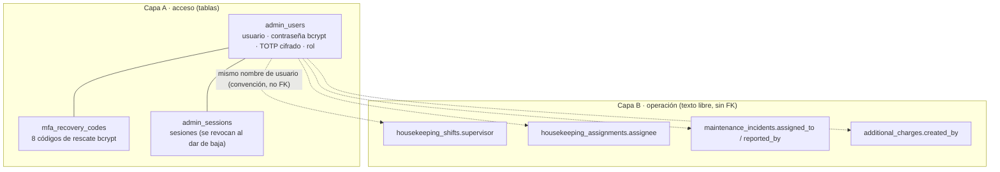
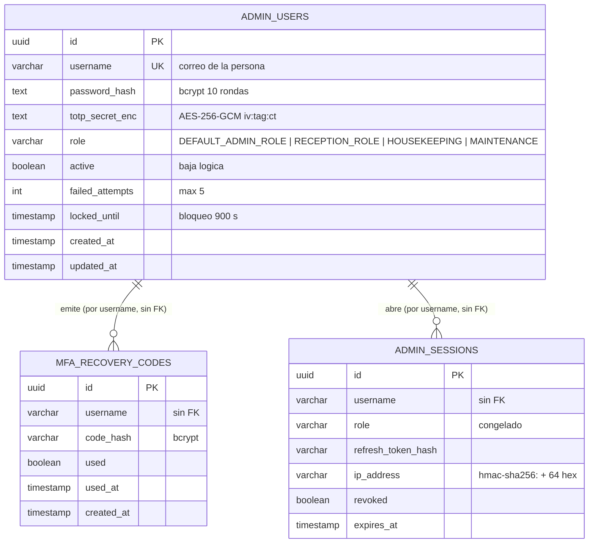
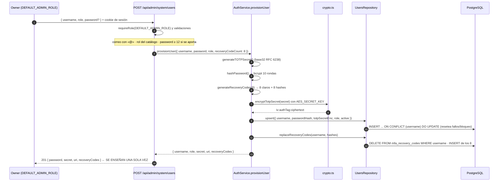
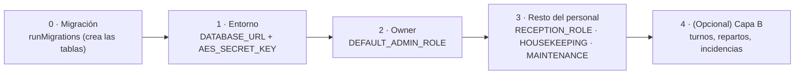

# Estructura de datos — Personal que opera el sistema (2026-10-05)

> **Skill**: `@inyecta-datos` · **Proyecto**: `hotel-room-mcp-trazable` · **Paso 1 (análisis)**
> **Alcance**: todo lo que hay que escribir para dar de alta a una persona del personal con acceso al
> panel (dueño, recepción, housekeeping, mantenimiento) y cómo se la referencia después en las
> operaciones del día a día.
> **Fuentes verificadas**: `RepoTecnico/base_datos.sql` §3.1–3.2, `packages/shared/src/db/migrator.ts`
> (migración en runtime), `packages/shared/src/db/repositories/users.repository.ts`,
> `packages/shared/src/auth/service.ts`, `packages/shared/src/auth/crypto.ts`,
> `packages/shared/src/domain/roles.ts`, `apps/web/src/app/api/admin/system/users/route.ts`,
> `apps/web/src/components/admin/system/SystemUsers.tsx`, `docs/SRS.md` (CU-42).

---

## 1. Resumen: el personal son dos capas

| Capa | Qué es | Dónde vive | ¿Tiene tabla maestra? |
|---|---|---|---|
| **A · Acceso al panel** | La cuenta de la persona: usuario, contraseña, segundo factor y rol | `admin_users` + `mfa_recovery_codes` | **Sí** (es el objeto de este documento) |
| **B · Personal operativo** | El nombre de quien supervisa un turno, limpia una habitación o atiende una incidencia | Columnas de texto `VARCHAR(100)` en turnos, repartos, incidencias y cargos | **No**: es texto libre, sin FK |

Consecuencia para la inyección: **crear la cuenta (capa A) no crea personal operativo (capa B)**. Son
dos escrituras distintas y la segunda no valida contra la primera.

**En una frase**: el personal que opera el sistema se da de alta en `admin_users` (con sus códigos de
rescate en `mfa_recovery_codes`); después su nombre se escribe como texto en las tablas de operación.

---

## 2. Entidad principal: `admin_users` — operadores (D-04 · IMPLEMENTADO)

Tabla canónica del maestro de personal. Su definición está **duplicada a propósito**: en
`RepoTecnico/base_datos.sql` (esquema de referencia) y en `packages/shared/src/db/migrator.ts`
(migración idempotente que se aplica en runtime). Ambas son idénticas.

| # | Campo | Tipo | Nulo | Default | Restricción / significado |
|---|---|---|---|---|---|
| 1 | `id` | `UUID` | no | `gen_random_uuid()` | **PK** (`pgcrypto`) |
| 2 | `username` | `VARCHAR(100)` | no | — | **UNIQUE**; identificador de acceso. En la práctica, el **correo** de la persona |
| 3 | `password_hash` | `TEXT` | no | — | **bcrypt** (10 rondas, `bcryptjs`). Nunca se guarda la contraseña en claro |
| 4 | `totp_secret_enc` | `TEXT` | no | — | Semilla TOTP **cifrada** con AES-256-GCM (clave `AES_SECRET_KEY`) |
| 5 | `role` | `VARCHAR(30)` | no | — | Rol de back-office (ver §4). **Sin `CHECK` en BD**: lo valida la aplicación |
| 6 | `active` | `BOOLEAN` | no | `TRUE` | Alta/baja lógica. Dar de baja = `FALSE` (no hay borrado) |
| 7 | `failed_attempts` | `INT` | no | `0` | Contador para el bloqueo por fuerza bruta (máx. 5) |
| 8 | `locked_until` | `TIMESTAMP` | **sí** | `NULL` | Fin del bloqueo temporal (900 s). `NULL` = no bloqueado |
| 9 | `created_at` | `TIMESTAMP` | no | `NOW()` | Alta de la ficha |
| 10 | `updated_at` | `TIMESTAMP` | no | `NOW()` | Se refresca en cada `upsert`/cambio de credenciales |

**Índices**: `idx_admin_users_username (username)` · `idx_admin_users_lock (active, locked_until)`.
El primero es redundante con el `UNIQUE`, pero está declarado; el segundo sirve al login (buscar
cuentas activas y no bloqueadas). No hay índice sobre `role`: filtrar por rol es un `seq scan` barato
con pocos operadores.

**Formato del criptograma TOTP** (`crypto.ts`): `iv_hex:authTag_hex:ciphertext_hex`, con IV de 12
bytes (NIST SP 800-38D) y etiqueta de 16 bytes. La clave de 32 bytes se deriva con
`SHA-256(AES_SECRET_KEY)`. **Sin `AES_SECRET_KEY` no se puede cifrar ni descifrar**: `requireSecret`
lanza `MissingSecretError` (falla en cerrado, CWE-798).

---

## 3. Entidad dependiente: `mfa_recovery_codes` — códigos de rescate

| Campo | Tipo | Nulo | Default | Significado |
|---|---|---|---|---|
| `id` | `UUID` | no | `gen_random_uuid()` | **PK** |
| `username` | `VARCHAR(100)` | no | — | Operador al que pertenece. **Sin FK**: se liga por nombre (así lo define el esquema) |
| `code_hash` | `VARCHAR(60)` | no | — | **bcrypt** del código (el código en claro son 10 caracteres hex en mayúsculas) |
| `used` | `BOOLEAN` | no | `FALSE` | Consumo de un solo uso |
| `used_at` | `TIMESTAMP` | sí | `NULL` | Momento del canje |
| `created_at` | `TIMESTAMP` | no | `NOW()` | Emisión |

**Índice**: `idx_mfa_codes_user (username, used)`.
**Invariante de escritura**: el alta **reemplaza** los códigos (`DELETE` por `username` + `INSERT` de
los nuevos). No se acumulan entre rotaciones. El consumo es atómico
(`UPDATE ... WHERE used = FALSE RETURNING id`), de modo que dos peticiones no canjean el mismo código.

---

## 4. Entidad afectada por el alta/baja: `admin_sessions`

No la escribe el alta del personal, pero **sí la tocan sus efectos**: al desactivar a alguien se
revocan sus sesiones (`revokeAllUserSessions`).

| Campo | Tipo | Nulo | Notas |
|---|---|---|---|
| `id` | `UUID` | no | **PK** |
| `username` | `VARCHAR(100)` | no | Operador (sin FK) |
| `role` | `VARCHAR(30)` | no | Rol **congelado** en la sesión |
| `refresh_token_hash` | `VARCHAR(64)` | no | Hash del refresh token |
| `ip_address` | `VARCHAR(80)` | sí | **Pseudonimizada**: `hmac-sha256:` + 64 hex (ADR-24), nunca la IP en claro |
| `user_agent` | `VARCHAR(80)` | sí | Misma pseudonimización |
| `revoked` | `BOOLEAN` | no | `TRUE` al dar de baja al operador |
| `expires_at` | `TIMESTAMP` | no | Caducidad (hay purga periódica) |
| `created_at` | `TIMESTAMP` | no | — |

---

## 5. Catálogo de roles (el valor que hay que elegir bien)

Fuente única: `BACK_OFFICE_ROLE_NAMES` en `packages/shared/src/domain/roles.ts` (D-04, D-56).

| `role` | Etiqueta del panel | Paneles que abre | Wallet on-chain |
|---|---|---|---|
| `DEFAULT_ADMIN_ROLE` | Dueño | **Todos** (admin, recepción, housekeeping, mantenimiento) | Cuenta 1 (Anvil) para el back-office; no va en la BD |
| `RECEPTION_ROLE` | Recepción | Front Office (check-in/check-out, cargos, estancias) | Cuenta 3 (hot-wallet de recepción) |
| `HOUSEKEEPING` | Housekeeping | Tablero de limpieza, turnos y reparto | **Ninguna** (D-56: rol de BD sin wallet) |
| `MAINTENANCE` | Mantenimiento | Incidencias y plan preventivo | **Ninguna** (D-56) |

> Los roles del contrato (`MINTER_ROLE`, `PAUSER_ROLE`, `BURNER_ROLE`, `TREASURER_ROLE`,
> `DEFAULT_ADMIN_ROLE` de Solidity) son **otra cosa** y se conceden en la pantalla de Contratos, no
> aquí. El rol de `admin_users` solo gobierna los paneles de la web.

**Regla de coherencia**: como la web **no firma por el operador** (cada wallet firma lo suyo, ADR-11),
el rol de BD no otorga permisos de cadena. Tener `RECEPTION_ROLE` en la BD **no** concede
`RECEPTION_ROLE` on-chain: son capas independientes.

---

## 6. Relaciones

---

## 7. Proceso de alta (lo que realmente escribe filas)

**Puntos de no retorno**: a partir del `201`, la contraseña en claro y los códigos de rescate **ya no
se pueden recuperar** (solo hay bcrypt en la BD); la semilla TOTP solo se recupera descifrando con
`AES_SECRET_KEY`. Si se pierden, la única salida es **rotar** (nuevo `upsert`).

---

## 8. Reglas de validación e invariantes

| # | Regla | Dónde se aplica | Efecto si se incumple |
|---|---|---|---|
| 1 | `username` es un correo: no vacío, ≤ 100, incluye `@` | `POST /api/admin/system/users` | `400 USUARIO_INVALIDO` |
| 2 | `role` ∈ catálogo de §5 | API (`ROLES`) y tipo `AdminUserRole` | `400 ROL_INVALIDO` |
| 3 | Si se aporta `password`, longitud ≥ 12 | API | `400 PASSWORD_INVALIDA` |
| 4 | Si no se aporta `password`, se genera (18 bytes → base64url, 24 caracteres) | API | — |
| 5 | `username` es **UNIQUE**: repetirlo **rota** credenciales | `upsert` con `ON CONFLICT` | Se invalidan TOTP y contraseña anteriores de esa persona |
| 6 | La rotación **resetea** `failed_attempts = 0` y `locked_until = NULL` | `upsert` | La cuenta queda utilizable de inmediato |
| 7 | Máx. 5 intentos fallidos → bloqueo 900 s | `registerFailedAttempt` | `locked_until = NOW() + 900 s`; al expirar se recuperan intentos |
| 8 | 8 códigos de rescate, de un solo uso, **reemplazados** en cada alta/rotación | `replaceRecoveryCodes` | Los antiguos dejan de valer |
| 9 | Dar de baja = `active = FALSE`, que además **revoca sesiones** | `PATCH` + `revokeAllUserSessions` | La persona sale del panel al instante |
| 10 | Un owner **no puede desactivarse a sí mismo** | `PATCH` | `400 AUTO_DESACTIVACION` |
| 11 | No hay `DELETE`: la ficha se conserva | No existe endpoint | Evidencia/auditoría preservada |
| 12 | Sin `AES_SECRET_KEY` no hay alta | `requireSecret` en `crypto.ts` | `MissingSecretError`, falla en cerrado (CWE-798) |
| 13 | `username` inexistente al desactivar | `PATCH` | `404 USUARIO_NO_ENCONTRADO` |

**Trazabilidad de datos personales (RNF-30 / RNF-41)**

- `username` (correo) es **dato personal**: vive **solo off-chain**; la cadena no lo conoce.
- La contraseña en claro **nunca se persiste ni se registra**: solo viaja en la respuesta del alta.
- La semilla TOTP va **cifrada en reposo**; los códigos de rescate, con bcrypt.
- La IP y el *user agent* de las sesiones van **pseudonimizados** con HMAC-SHA256 (ADR-24).
- La API de listado (`GET`) devuelve una **vista pública** sin `password_hash` ni `totp_secret_enc`.

---

## 9. Capa B: dónde se referencia al personal operativo

No hay tabla de empleados. Estas columnas guardan el **nombre** de la persona como texto
`VARCHAR(100)`, sin FK ni validación contra `admin_users`:

| Tabla | Columna | Nulo | Quién lo escribe hoy |
|---|---|---|---|
| `housekeeping_shifts` | `supervisor` | no | Alta de turno; por defecto, el `username` de la sesión |
| `housekeeping_assignments` | `assignee` | no | Reparto automático o ajuste manual del tablero |
| `housekeeping_room_logs` | `changed_by` | no | Cambio de estado operativo de la habitación |
| `maintenance_incidents` | `reported_by` / `assigned_to` / `resolved_by` | / sí / sí | Alta, asignación y resolución de incidencia |
| `maintenance_incident_events` | `actor` | no | Bitácora de la incidencia |
| `additional_charges` | `created_by` / `cancelled_by` | / sí | Cargos de la estancia |
| `activity_bookings` | `created_by` | no | Inscripción en actividad |
| `supply_stock_movements` | `created_by` | no | Movimiento de lencería/suministros |

**Convención observada**: la UI rellena el campo con el `username` de la sesión (el correo) cuando no
se escribe un nombre. Si se quiere que el panel muestre nombres legibles («Marta R.»), hay que
escribirlos **así** en la capa B: la plataforma no traduce correo → nombre.

---

## 10. Orden de inserción y dependencias

1. **Migración primero**: `runMigrations(getDbPool())` crea `admin_users` y `mfa_recovery_codes` si no
   existen (idempotente).
2. **Entorno**: `DATABASE_URL` (PostgreSQL) y `AES_SECRET_KEY` (obligatoria, sin default).
3. **Owner antes que nadie**: sin un `DEFAULT_ADMIN_ROLE` activo no hay quien entre a Sistemas →
   Usuarios ni quien firme los `POST`.
4. **El resto, en cualquier orden**: los cuatro roles son independientes entre sí.
5. **Capa B al final**: necesita que existan habitaciones (`rooms`) para los repartos y turnos.

---

## 11. Estado actual y qué falta

| Elemento | Estado verificado |
|---|---|
| Tablas `admin_users` / `mfa_recovery_codes` | Definidas en esquema y migración; se crean en runtime |
| `admin@hotel.es` (`DEFAULT_ADMIN_ROLE`) | **Existe** (creado por `inject-data.ts`); no rotar sin motivo |
| `recepcion@hotel.es` (`RECEPTION_ROLE`) | **Existe** (creado por `inject-data.ts`) |
| Cuentas `HOUSEKEEPING` | **No existen** |
| Cuentas `MAINTENANCE` | **No existen** |
| Personal operativo (capa B) | Sin inyectar (los turnos se crean desde el panel) |
| Servidor MCP | **No** expone gestión de personal (verificado: sin herramientas de operadores) |
| `DELETE` de operadores | No implementado (la baja es `active = false`) |

---

## 12. Vías de escritura (ambas válidas; la elección afecta al script)

| | Vía API (canónica) | Vía directa a BD |
|---|---|---|
| Endpoint / clase | `POST /api/admin/system/users` → `AuthService.provisionUser` | `AuthService.provisionUser` importado desde `@hotel/shared` |
| Requiere | Web levantada + owner con MFA (contraseña + TOTP) | `DATABASE_URL` + `AES_SECRET_KEY` |
| Ventajas | Ejercita el flujo real y queda en la sesión/auditoría | No exige web ni Anvil; sirve con la app parada |
| Inconvenientes | Depende de la web y de las credenciales del owner | Salta el guard HTTP (no hay sesión ni auditoría de acceso) |
| Reutilizado por | UI `SystemUsers`, `planta.ts` | `inject-data.ts` (paso «Operadores de la base de datos») |

En ambos casos el material criptográfico lo produce `AuthService`: **nunca** se escribe un hash bcrypt
ni un criptograma a mano por SQL.

---

## 13. Trazabilidad

| Referencia | Dónde | Qué fija |
|---|---|---|
| **RF-42 / CU-42** | `docs/SRS.md:376` | Gestionar usuarios: listar, crear/rotar, activar/desactivar |
| **D-04** | `migrator.ts`, `service.ts` | `admin_users` como sistema canónico de autenticación (bcrypt + TOTP) |
| **D-43** | `docs/SRS.md:376` | Ruta `POST /api/admin/system/users` y pantalla `SystemUsers` |
| **D-56** | `domain/roles.ts` | `HOUSEKEEPING` y `MAINTENANCE` como roles de BD **sin wallet** |
| **RNF-41** | `users.repository.ts`, route `GET` | La API nunca expone `password_hash` ni `totp_secret_enc` |
| **RNF-30** | `base_datos.sql` §3.3 | Los datos personales son **off-chain** |
| **ADR-24** | `crypto.ts` | IP/user agent pseudonimizados con HMAC-SHA256 en `admin_sessions` |
| **ADR-11** | — | La web no firma transacciones por el operador |
| **CWE-798** | `env/index.ts` | Sin `AES_SECRET_KEY` se falla en cerrado (no hay clave por defecto) |

---

## 14. Decisiones pendientes antes de generar el script de inyección

1. **Alcance**: ¿solo cuentas del panel (capa A), o también turnos/repartos/incidencias (capa B)?
2. **Método**: ¿vía API (flujo canónico, exige web + MFA del owner) o vía directa a BD
   (`AuthService.provisionUser`, no exige web)?
3. **Plantilla**: ¿cuántas personas y con qué correos por rol? (hoy solo existen owner y recepción).

Con esas tres respuestas se escribe el plan de inyección (Paso 5) y, aprobado, el script
`scripts/personal.ts` (Paso 6): idempotente por `username`, con confirmación interactiva, registro en
`.deploy-logs/` y credenciales impresas **una sola vez**.
