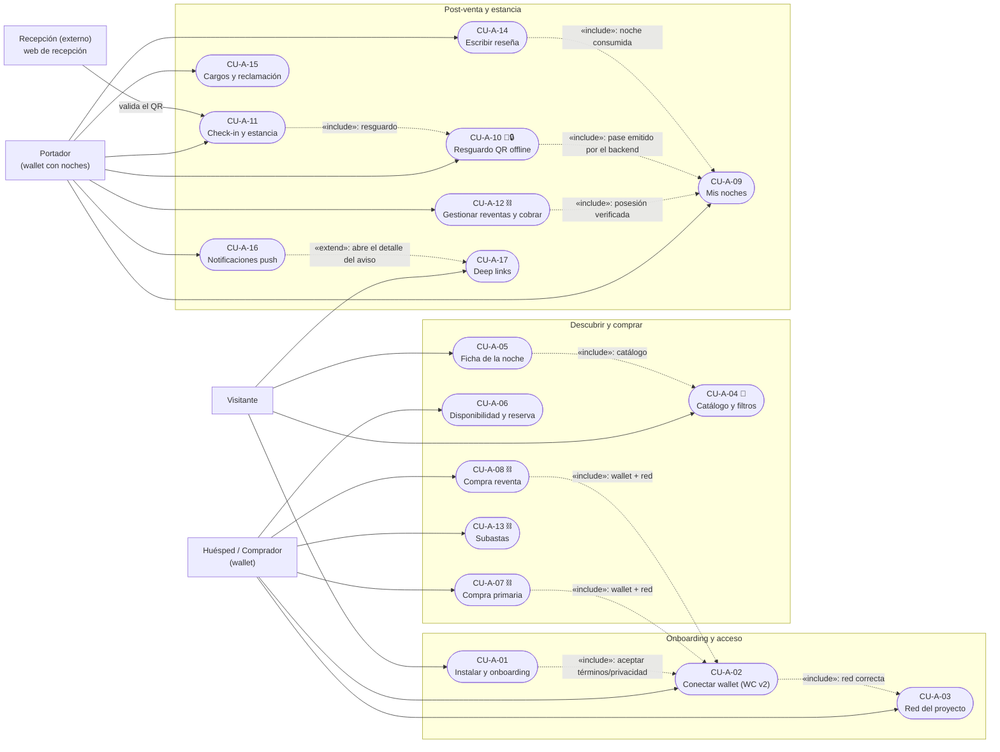
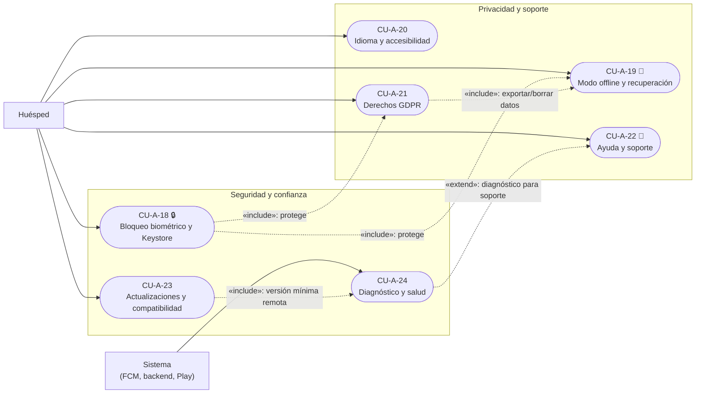

# Diagrama de casos de uso — APK Android del huésped (v1)

> **Tipo:** representación gráfica UML de casos de uso en **Mermaid** (Fase 2).
> **Fuente única:** [`RepoTecnico/casos_uso_apk.md`](../casos_uso_apk.md) (CU-A-01…CU-A-24 y decisiones
> ratificadas A-1/A-2/A-3).
> **Fecha:** 2026-10-20 · **Versión:** 1.0.0.
>
> **Convenciones**
> - Rectángulo = actor; esquinas redondeadas = caso de uso `CU-A-XX`.
> - `-->` asociación; `-.->` «include»/«extend» rotulado.
> - ⛓ = firma en wallet (no custodial); 📴 = funciona sin conexión; 🔒 = requiere protección del
>   dispositivo (biometría/Keystore).
> - Por volumen (24 CU-A) se divide en **2 bloques**: viaje del huésped y protección/plataforma.

---

## 1. Bloque viaje del huésped

**Notas.** `CU-A-02/03` son requisito de toda operación con firma (⛓). El **resguardo** (CU-A-10) es el
único caso que debe funcionar **sin red** (📴) y bajo **bloqueo del dispositivo** (🔒); el check-in lo
ejecuta la web de recepción, no la app.

---

## 2. Bloque protección, privacidad y plataforma

**Notas.** `CU-A-18` aplica **biometría obligatoria** y **Play Integrity opcional** (decisión A-3); con
Integrity activo y dispositivo no aprobado, la app queda en solo lectura. `CU-A-24` no persiste PII.

---

## 3. Relaciones «include»/«extend» relevantes (resumen)

| Relación | Desde → hacia | Tipo | Motivo |
|---|---|---|---|
| Onboarding exige términos | CU-A-01 → CU-A-02 | include | sin aceptación no se conecta wallet |
| Toda compra exige wallet/red | CU-A-07/08/13 → CU-A-02/03 | include | no se firma sin wallet en red 81234 |
| Resguardo exige pase emitido | CU-A-10 → CU-A-09 | include | el pase lo emite el backend |
| Check-in exige resguardo | CU-A-11 → CU-A-10 | include | el QR es la entrada |
| Push abre detalle | CU-A-16 → CU-A-17 | extend | solo si el usuario toca la notificación |
| Protección cubre datos | CU-A-18 → CU-A-19/21 | include | Keystore/biometría sobre caché y datos |
| Actualización obligatoria | CU-A-23 → CU-A-24 | include | versión mínima desde backend |
| GDPR usa export local | CU-A-21 → CU-A-19 | include | exportar/borrar datos guardados |
