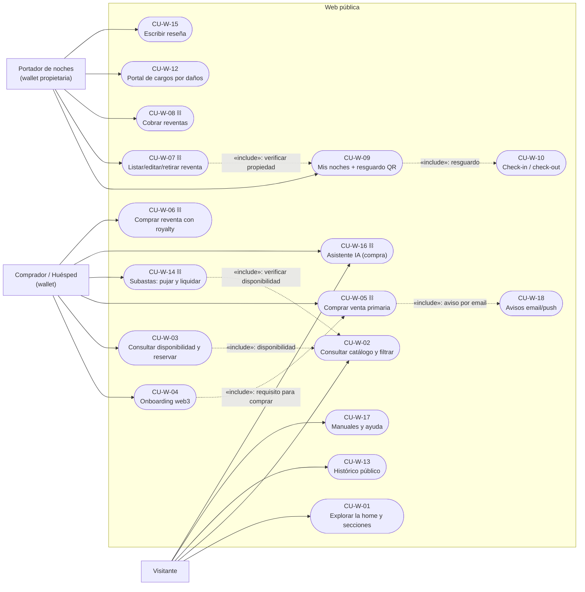
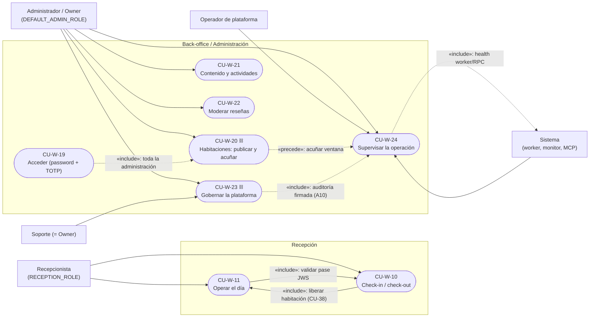
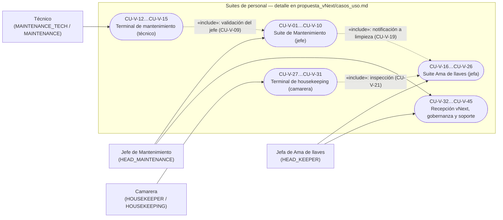

# Diagrama de casos de uso — WEB (implementación F1–F10)

> **Tipo:** representación gráfica UML de casos de uso en **Mermaid** (Fase 2).
> **Fuente única:** [`RepoTecnico/casos_uso_web.md`](../casos_uso_web.md) (CU-W-01…CU-W-24, actores y
> objetivos literales del §2/§3). Los CU heredados (`CU-01…CU-50`, `CU-V-01…CU-V-45`) se consolidan en el
> §5 de ese documento y **no se repiten** en estos diagramas.
> **Fecha:** 2026-10-20 · **Versión:** 1.0.0.
>
> **Convenciones**
> - Rectángulo = **actor** (rol entre paréntesis).
> - Esquinas redondeadas = **caso de uso** `CU-W-XX` con el objetivo literal.
> - `-->` = asociación actor → caso de uso; `-.->` = relación UML **«include»**/**«extend»**, rotulada.
> - ⛓ = caso con **firma on-chain selectiva** (requiere wallet + preview; RF-S-07).
> - Por volumen (24 CU-W, 8 actores) el modelo se divide en **3 bloques**: público/huésped, back-office
>   y operación, y suites de personal (referencia a `propuesta_vNext/casos_uso.md`).

---

## 1. Bloque público y huésped

**Notas.** La compra primaria/reventa y la subasta son las únicas acciones de escritura on-chain del
huésped (⛓), además de listar/cobrar reventas; el resto es lectura o escritura off-chain auditada.
`CU-W-10` es un objetivo compartido: el huésped muestra el pase y la **recepción** ejecuta el check-in
(ver bloque 2).

---

## 2. Bloque recepción, back-office y operación

**Notas.** `CU-W-23` se mantiene como **paraguas** de gobernanza (subcasos 23.1–23.6: usuarios, wallets
on-chain, flags, operarios de terminal, auditoría/backups y subastas). El owner satisface cualquier
requisito de rol (D-30). Las suites de personal no se dibujan aquí: ver bloque 3.

---

## 3. Bloque suites de personal (referencia consolidada)

> Los criterios Gherkin/EARS de los 45 CU-V viven en
> [`propuesta_vNext/casos_uso.md`](../propuesta_vNext/casos_uso.md); su estado de implementación y
> evidencia están consolidados en [`casos_uso_web.md`](../casos_uso_web.md) §5.3.

---

## 4. Relaciones «include»/«extend» relevantes (resumen)

| Relación | Desde → hacia | Tipo | Motivo |
|---|---|---|---|
| Comprar exige onboarding | CU-W-05 → CU-W-04 | include | sin wallet/red no se puede firmar |
| Reservar exige catálogo | CU-W-03 → CU-W-02 | include | la disponibilidad se elige sobre el catálogo |
| Resguardo para check-in | CU-W-09 → CU-W-10 | include | el pase es la entrada al check-in |
| Aviso tras la compra | CU-W-05 → CU-W-18 | include | email/push al comprador y al admin |
| Editar precio de reventa | CU-W-07 → CU-W-06 | extend | solo si ya está listada |
| Subasta exige disponibilidad | CU-W-14 → CU-W-02 | include | la noche debe ser vendible |
| Administración exige sesión | CU-W-20…24 → CU-W-19 | include | gate de sesión en servidor |
| Auditoría en la gobernanza | CU-W-23 → CU-W-24 | include | export/cola verificables |
| Check-out libera habitación | CU-W-10 → CU-W-11 | include | estado operativo `PENDING_CLEANING` |
