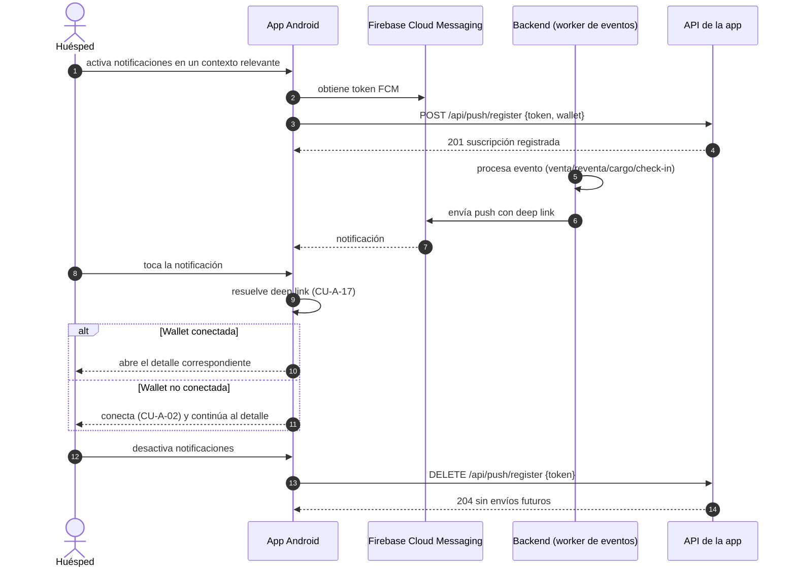
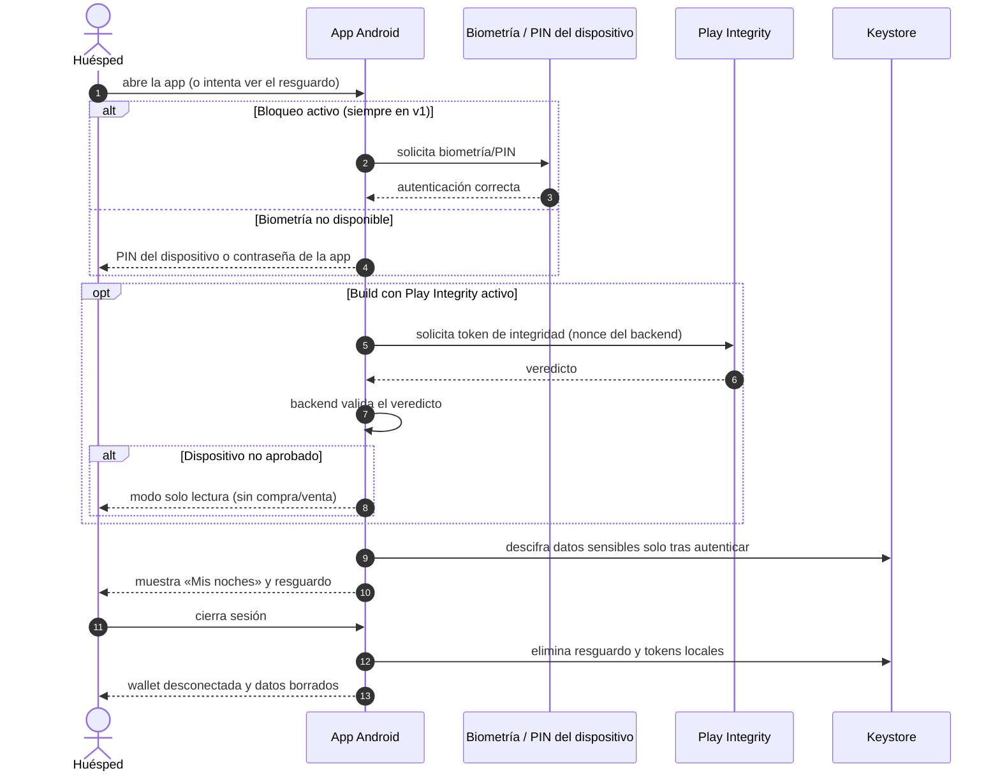

# Diagramas de secuencia — APK Android del huésped (v1)

> **Tipo:** diagramas de secuencia UML (Mermaid) de los flujos principales de la APK.
> **Fuente única:** [`RepoTecnico/casos_uso_apk.md`](../casos_uso_apk.md) (flujo principal, alternativos y
> restricciones EARS) y decisiones ratificadas A-1/A-2/A-3.
> **Fecha:** 2026-10-20 · **Versión:** 1.0.0.
>
> **Convenciones:** `->>`/`-->>`; `alt`/`else` para alternativos; la app **nunca** firma por el usuario:
> la firma ocurre en la wallet vía WalletConnect/deep link.

---

## 1. CU-A-07 — Compra primaria desde la APK

```mermaid
sequenceDiagram
    autonumber
    actor HUE as Huésped
    participant APP as App Android (Compose)
    participant WC as Wallet (WalletConnect v2 / MetaMask)
    participant BE as Backend web/API
    participant RPC as RPC / contrato HotelNights

    HUE->>APP: abre una noche y pulsa «Comprar»
    APP->>BE: GET /api/nfts (disponibilidad y precio)
    BE-->>APP: noche PUBLISHED y precio
    alt Sin wallet conectada
        APP-->>HUE: onboarding CU-A-02 (conectar)
    else Red distinta de 81234
        APP-->>HUE: aviso red incorrecta y cambio (CU-A-03)
    else Flujo correcto
        APP-->>HUE: resumen + confirmación explícita
        HUE->>APP: confirma
        APP->>WC: solicita firma de tx buy(tokenId)
        WC->>RPC: eth_sendTransaction
        WC-->>APP: hash
        loop Espera del recibo
            APP->>RPC: eth_getTransactionReceipt
            RPC-->>APP: status
        end
        alt Revert
            APP-->>HUE: motivo canónico y reintento
        else Confirmada
            RPC-->>BE: evento Sale(PRIMARY)
            APP-->>HUE: compra confirmada; noche en «Mis noches»
        end
    end
```

**Oráculos:** hash visible, estado de tx persistido, `/mis-noches` actualizado, evento `Sale`.

---

## 2. CU-A-10 — Emitir y guardar el resguardo QR offline

```mermaid
sequenceDiagram
    autonumber
    actor HUE as Huésped
    participant APP as App Android
    participant BE as Backend (API de pases)
    participant KS as Android Keystore / EncryptedFile
    participant REC as Recepción (web, sin red en la app)

    HUE->>APP: abre «Mis noches» y pulsa «Guardar resguardo»
    APP->>BE: POST /api/wallet/pass/{tokenId} (firma EIP-712 del titular)
    BE->>BE: verifica ownerOf on-chain y firma; emite JWS con jti de un solo uso
    BE-->>APP: pase (JWS + QR)
    APP->>KS: guarda el pase cifrado
    APP-->>HUE: «Resguardo disponible sin conexión»

    Note over HUE,REC: más tarde, en recepción y sin cobertura
    HUE->>APP: abre el resguardo offline
    APP->>KS: descifra (requiere biometría/PIN)
    APP-->>HUE: QR a pantalla completa
    HUE->>REC: muestra el QR
    REC->>BE: valida QR (check-in)
    alt jti ya usado
        BE-->>REC: 409 TICKET_YA_USADO
    else válido
        BE-->>REC: check-in registrado
        REC-->>HUE: check-in completado (sin necesidad de red en la app)
    end
```

**Oráculos:** archivo cifrado en Keystore, QR visible sin red, consumo de `jti` en recepción.

---

## 3. CU-A-16 — Notificación push y deep link al detalle



**Oráculos:** token registrado/eliminado, payload con deep link, navegación al detalle.

---

## 4. CU-A-18 — Protección: biometría obligatoria y Play Integrity opcional



**Oráculos:** biometría/PIN solicitado, veredicto de Integrity, Keystore, limpieza al desconectar.

---

## 5. Relación con la web

| Flujo APK | Equivalente web | Diferencia |
|---|---|---|
| CU-A-07 compra | CU-W-05 | Misma cadena/contrato; wallet vía WalletConnect/deep link |
| CU-A-10 resguardo | CU-W-09 | La APK añade almacenamiento cifrado y visualización **offline** |
| CU-A-16 push | CU-W-18 | FCM en lugar de Web Push |
| CU-A-18 protección | — | Nuevo en APK (biometría Keystore + Integrity opcional) |
