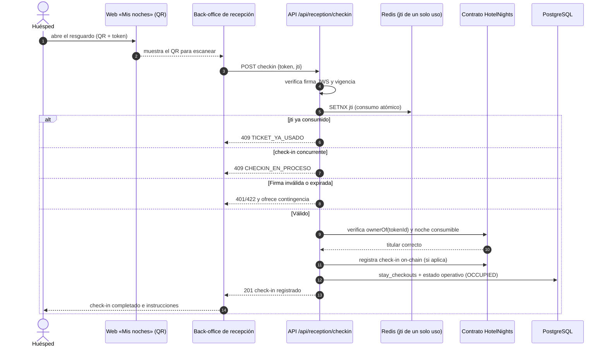
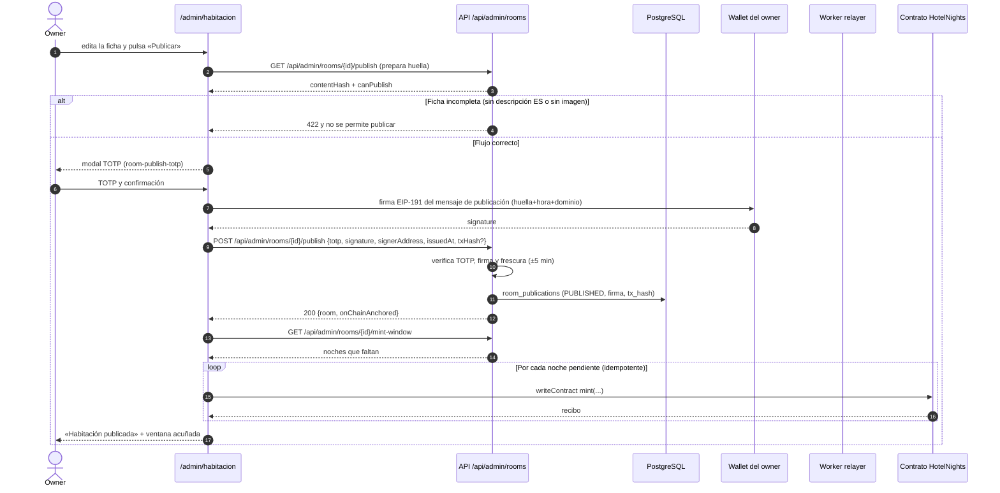
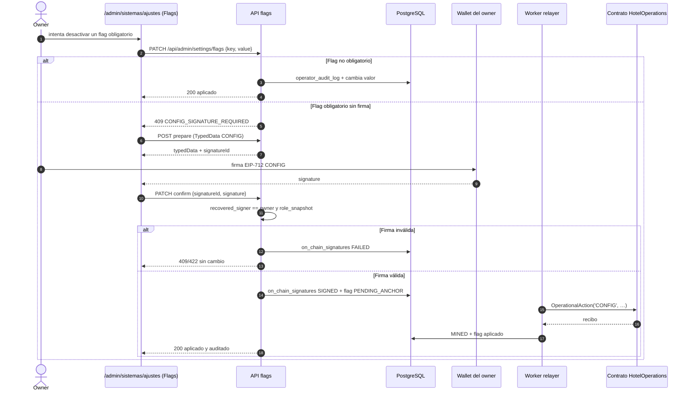

# Diagramas de secuencia — WEB (flujos clave)

> **Tipo:** diagramas de secuencia UML (Mermaid) de los flujos principales de los CU-W clave.
> **Fuente única:** [`RepoTecnico/casos_uso_web.md`](../casos_uso_web.md) (flujo principal, alternativos y
> restricciones EARS de cada CU). Vocabulario de estados según `diccionario_datos.md`/`base_datos.sql`.
> **Fecha:** 2026-10-20 · **Versión:** 1.0.0.
>
> **Convenciones:** mensajes `->>`, respuestas `-->>`; `alt`/`else` para alternativos, `opt`/`loop` para
> tramos opcionales/repetitivos. Los valores de estado son los canónicos (`PUBLISHED`, `MAINTENANCE`,
> `PENDING_ANCHOR`, `SIGNED`, `MINED`, `PENDING_CLEANING`, …).

---

## 1. CU-W-05 — Compra primaria (firma del comprador)

```mermaid
sequenceDiagram
    autonumber
    actor COMP as Comprador
    participant UI as Web (catálogo/mis noches)
    participant W as Wallet (EIP-6963/WalletConnect)
    participant API as API web (BFF)
    participant RPC as RPC / contrato HotelNights
    participant WK as Worker (indexador/avisos)

    COMP->>UI: abre la noche y pulsa «Comprar»
    UI->>API: GET /api/nfts (estado y precio)
    API->>RPC: lectura de disponibilidad (ownerOf/priceOf)
    RPC-->>API: noche PUBLISHED y sin dueño
    API-->>UI: resumen (habitación, fecha, precio)
    alt Contrato en pausa
        API-->>UI: 423/409 PAUSED
        UI-->>COMP: compra deshabilitada con aviso
    else Sin wallet o red incorrecta
        UI-->>COMP: onboarding (CU-W-04) o cambio de red, sin firmar
    else Flujo correcto
        UI-->>COMP: confirmación explícita (sin firmar en servidor)
        COMP->>W: firma tx buy(tokenId)
        W->>RPC: eth_sendTransaction
        RPC-->>UI: hash de transacción
        UI->>API: POST /api/nfts/confirm (hash) [opcional]
        loop Espera del recibo
            UI->>RPC: eth_getTransactionReceipt
            RPC-->>UI: status
        end
        alt Tx revertida
            UI-->>COMP: mensaje canónico del revert, noche no comprada
        else Tx confirmada
            RPC-->>WK: evento Sale(PRIMARY)
            WK->>API: indexa y encola email al admin
            UI-->>COMP: tx confirmada; navega a «Mis noches»
        end
    end
```

**Evidencia E2E:** `home.spec.ts`, a11y y el E2E de compra; contrato: `forge test` (`buy`).

---

## 2. CU-W-10 — Check-in en recepción con pase QR/JWS



**Evidencia:** `/api/reception/checkin`, `passes/jws.ts`, E2E de check-in y evidencia F7/F10.

---

## 3. CU-W-20 — Publicar ficha firmada y acuñar la ventana



**Evidencia:** `apps/web/e2e/wallet-publicacion.spec.ts` (A5), tests de publicación/firma y §48 del estado.

---

## 4. CU-W-23 — Gobernanza: desactivar un flag obligatorio con firma `CONFIG`



**Evidencia:** F9 (`flags` con firma CONFIG), `on_chain_signatures`, `operator_audit_log`; E2E F9.

---

## 5. Relación con los CU heredados

| Flujo | CU fuente | Secuencia equivalente en la documentación previa |
|---|---|---|
| Compra primaria | CU-W-05 / CU-05 | `propuesta_vNext/casos_uso/diagramas_secuencia.md` (venta primaria) |
| Check-in | CU-W-10 / CU-08/CU-33 | ADR-05 (JWS + jti de un solo uso) |
| Publicación firmada | CU-W-20 / CU-02 | ADR-30 (mensaje legible) y F1/F8 |
| Gobernanza/flags | CU-W-23 / CU-V-37 | `propuesta_vNext/casos_uso/diagramas_secuencia.md` (firma CONFIG) |
