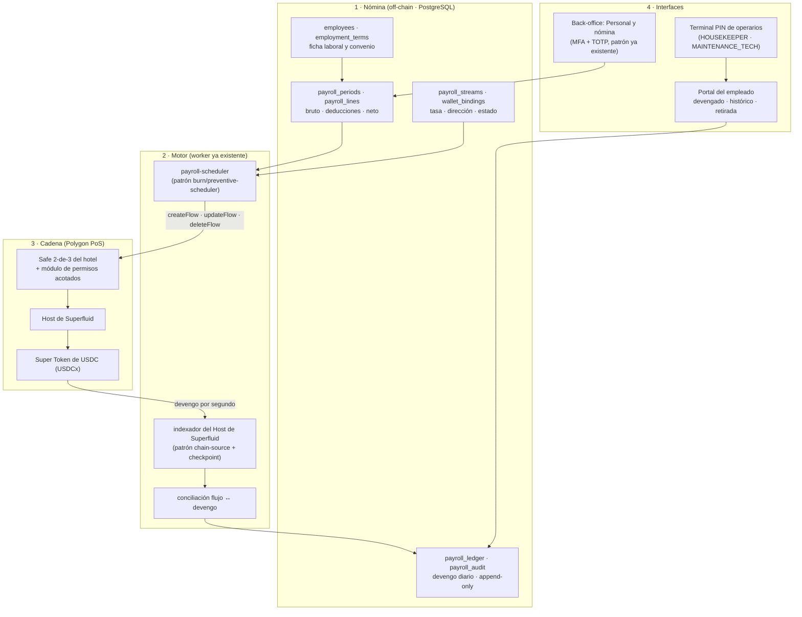
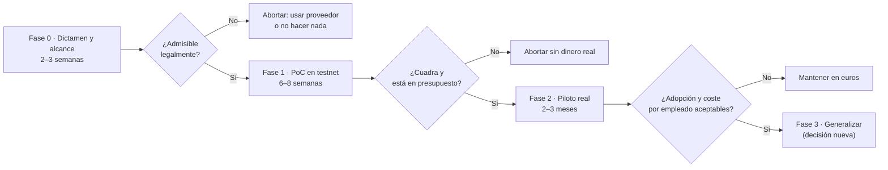
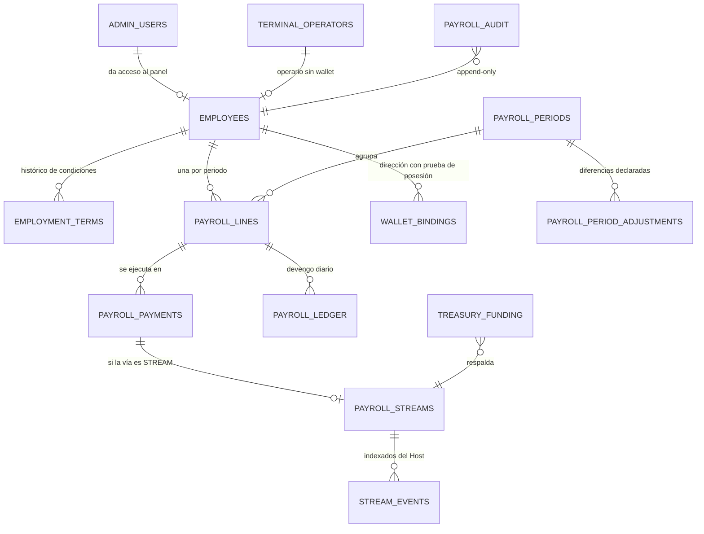

# Propuesta de pago de nómina por *streaming* con Superfluid

## Hotel Marina del Sol — documento para la Junta Directiva

> **Para**: Junta Directiva del Hotel Marina del Sol (Alicante)
> **De**: Dirección técnica del proyecto `hotel-room-mcp-trazable`
> **Fecha**: 2026-10-11 · **Versión**: 1.1.0 *(la 1.0.0 no analizaba el proyecto propio `superfluid`; esta
> versión lo incorpora en §2.4, §3.4, §4.10, §7.4 y el anexo H)*
> **Estado**: **PROPUESTA — no aprobada y no ejecutada**. Este documento no modifica el sistema: lo analiza.
> **Base del análisis**: (a) este repositorio en el commit `60d3d7b` (rama `Hotel-DSH-GCP`); (b) el proyecto
> propio **`/home/dsh/workspace/superfluid`** («Superfluid EUR Streaming v1 beta»), analizado fichero a
> fichero y resumido en el **anexo H**; (c) investigación externa del **protocolo oficial** Superfluid y del
> marco laboral/fiscal español, con fuentes citadas en el anexo F.
> **Advertencia de alcance**: este documento **no es un dictamen jurídico**. Las conclusiones legales y
> fiscales son **criterios de trabajo** que deben ser validados y firmados por un abogado laboralista y un
> asesor fiscal antes de pagar un solo euro por esta vía, en la misma línea que ya fija
> [`docs/COMPLIANCE.md`](../docs/COMPLIANCE.md).

---

## 0. Cómo leer este documento

| Si usted... | Vaya a |
|---|---|
| Tiene 10 minutos y decide | **§1 Resumen ejecutivo** y **§10 Decisiones que se solicitan** |
| Quiere saber de dónde partimos | **§2 El punto de partida verificado** |
| Quiere entender la idea | **§3 Qué es Superfluid y qué encaja (y qué no) con una nómina** |
| Quiere ver cómo se construiría | **§4 Diseño propuesto** |
| Quiere el balance honesto | **§5 Ventajas** · **§6 Desventajas y riesgos** |
| Quiere los números | **§7 Estimación de costes** |
| Quiere el plan y la salida de emergencia | **§8 Plan de implantación y criterios de aborto** |
| Quiere el detalle técnico o legal | **Anexos A–H** |
| Quiere saber qué hay ya construido y qué se puede reutilizar | **§2.4** y **Anexo H** |

Tres convenciones que este documento respeta y que conviene fijar de entrada:

- **Lo verificado se cita; lo estimado se marca como estimación; lo que no se sabe se declara desconocido.**
  La documentación de este proyecto ya se reescribió una vez precisamente porque describía intenciones
  como si fueran entregas ([`docs/FIAT-ONRAMP.md`](../docs/FIAT-ONRAMP.md) §1). No se repite ese error.
- **Los importes son euros** y, cuando son estimaciones, van con rango, no con una cifra falsamente exacta.
- **La decisión que se pide no es «cripto sí o no»**, sino un alcance concreto y reversible (una prueba
  de concepto y un piloto acotado), con condiciones de aborto escritas de antemano (§8).

---

## 1. Resumen ejecutivo

### 1.1 Qué se propone y qué no

**Se propone** analizar y, si la junta lo aprueba, **probar** el pago de un **complemento voluntario y
acotado** de la retribución mediante *streaming* con Superfluid, **manteniendo el salario fijo en euros
por transferencia**.

**No se propone**: pagar la nómina en cripto, sustituir la transferencia, custodiar fondos de empleados,
publicar salarios o direcciones en una cadena pública, ni empezar a construir antes de tener el dictamen
jurídico.

### 1.2 Los cuatro hechos que deciden

| # | Hecho verificado | Consecuencia |
|---|---|---|
| 1 | **Legal**: el salario se abona en euros y la parte en especie tiene un techo del **30 %**, sin poder minorar el SMI en dinero (anexo B §2–§3) | Para el personal en torno al SMI —**la mayoría de la plantilla, y justo la que no tiene wallet**— el techo es **cero**. El «pago de la nómina con Superfluid» no es viable en España |
| 2 | **Económico**: construir cuesta **55.000–105.000 €** (una vez) + **8.000–22.000 €/año**; comprar un proveedor cuesta **≈ 1.100–8.200 €/año** (§7) | La vía propia es **más de 100.000 € más cara en tres años**, y no se recupera con comisiones bancarias, que hoy son prácticamente cero |
| 3 | **Técnico**: el protocolo **no cobra comisión**, el gas es marginal y el *buffer* es despreciable (anexo A §2) | El coste no está en la cadena: está en el **dictamen, la conversión de euros, la custodia, la conciliación y el mantenimiento** |
| 4 | **Activo existente**: ya hay un proyecto propio **construido, probado y desplegado** que implementa el *streaming* (`superfluid`, `EURx` sobre Besu **81234**, misma organización y **misma identidad de cadena** que este repositorio) | Abarata y desriesga la prueba de concepto (**≈ 4.000–6.500 €**, 10 dp, en lugar de 5.600–9.100 €), pero **no resuelve el problema real**: su token no está respaldado y **su propia licencia prohíbe expresamente pagar nóminas con él** (§2.4 y anexo H) |

### 1.3 Cifras clave

| Concepto | Importe |
|---|---|
| Construcción completa (F0 + F1 + F2) | **55.000–105.000 €** (central ≈ 77.000 €) |
| Solo dictamen + prueba de concepto en testnet (F0 + F1) | **36.000–65.000 €** |
| PoC mínima **reutilizando el proyecto propio `superfluid`** (5 flujos de prueba, sin dinero real) | **4.000–6.500 €** |
| Demostrador mínimo construido **desde cero**, sin reutilizar nada | **5.600–9.100 €** |
| Coste recurrente anual, si se construye | **8.000–22.000 €/año** |
| Alternativa comprada (proveedor especializado) | **≈ 1.100–8.200 €/año** |
| Coste por empleado y mes a 3 años (25 empleados) | **≈ 130 €** construyendo · **≈ 7 €** comprando |
| Tesorería inmovilizada (si se streamea el 10 % del neto) | **2.000 / 4.100 / 6.600 €** según 12/25/40 empleados |
| Gas y comisión de protocolo | **≈ 0** en términos relativos (§7.5) |

### 1.4 Recomendación de la dirección técnica

1. **No convertir la nómina del hotel en un pago en criptoactivos.** Ni completa ni mayoritariamente: el
   techo legal lo impide para buena parte de la plantilla y el coste no se justifica.
2. **Si la junta quiere explorar la vía, aprobar solo F0 + F1**: dictamen jurídico y prueba de concepto en
   **testnet, sin dinero real y sin datos personales**, por **36.000–65.000 €**; y **para la PoC, reutilizar
   el proyecto propio `superfluid`**, que ya está construido y probado, con lo que esa parte baja a
   **4.000–6.500 €** (§7.4). Con ese resultado, la decisión de construir o comprar se toma con datos
   propios, no con estimaciones.
3. **Si el objetivo real es mejorar la liquidez del empleado**, hay vías mucho más baratas, sin riesgo legal
   y sin tecnología nueva (anticipos sin coste, pago quincenal del variable, propinas semanales). Se
   detallan en §9.5 y son las que la dirección técnica recomendaría **antes** que cualquier proyecto de
   *streaming*.
4. **Nada de esto debe arrancar** antes de cerrar el *gate* legal que el propio proyecto ya tiene abierto
   ([`docs/COMPLIANCE.md`](../docs/COMPLIANCE.md) §7).

### 1.5 Lo que se pide a la junta

Cinco decisiones concretas, con su coste y su alternativa, en **§10**. La más importante: **aprobar o
rechazar el dictamen previo (D-1)**. Sin él, cualquier euro invertido en desarrollo es dinero en riesgo.

---

## 2. El punto de partida verificado: qué hay hoy y qué no

Esta sección responde a una pregunta que la junta debe poder comprobar: **¿cuánto de esto ya está
construido?** La respuesta corta es: *la plataforma sobre la que se pagaría está construida y es sólida;
el pago de nómina, no existe en absoluto*.

### 2.1 Lo que sí existe (con su evidencia)

| Hecho verificado | Dónde se comprueba |
|---|---|
| Plataforma hotelera **desplegada y verificada** en Google Cloud: web (Next.js + React), worker con planificadores y colas (BullMQ), MCP, monitor | `apps/web`, `apps/worker`, `apps/mcp`, `apps/monitor`; [`despliegue_gcp.md`](./despliegue_gcp.md) §1–§2 (Cloud Run `europe-west1`, Cloud SQL `hotel-mcp-pg`, Redis, Anvil compartido `chainId 31337`). **Ojo**: es un entorno de despliegue sobre una cadena de simulación; la fase pública en red pública sigue pendiente ([`ADR-01`](../docs/adr/ADR-01-red-y-contrato-canonicos.md)) |
| **60 tablas** en el runtime, con migración idempotente y aditiva | `packages/shared/src/db/migrator.ts` (61 `CREATE TABLE IF NOT EXISTS`) |
| Personal ya modelado en dos capas: cuentas de acceso (`admin_users`, con MFA/TOTP y roles) y operarios de terminal (`terminal_operators`, con PIN) | `migrator.ts:113` y `migrator.ts:964`; [`estructura_datos_personal.md`](./BaseOperaciones/estructura_datos_personal.md) §1, §5 |
| Catálogo de roles de personal, con **distinción explícita entre quien tiene wallet y quien no** | `packages/shared/src/domain/roles.ts`: `WALLET_BACK_OFFICE_ROLE_NAMES = ["HEAD_MAINTENANCE","HEAD_KEEPER"]` y `TERMINAL_BACK_OFFICE_ROLE_NAMES = ["MAINTENANCE_TECH","HOUSEKEEPER"]` («**Sin wallet**: usa el terminal con PIN») |
| Wallets de operadores con roles on-chain y registro de firmas | `migrator.ts:993` (`operator_wallets`), `migrator.ts:1018` (`on_chain_signatures`) |
| Auditoría append-only de acciones de operadores (trigger que prohíbe UPDATE/DELETE) | `migrator.ts:1230` (`operator_audit_log` + `trg_operator_audit_append_only`) |
| Tesorería on-chain con rol segregado y retirada por *pull* | `packages/contracts/src/HotelNights.sol:324` (`withdraw`, `onlyRole(TREASURER_ROLE)`); [`ADR-15`](../docs/adr/ADR-15-pull-over-push.md) |
| Gobernanza con multisig 2-de-3 previsto (pendiente de nombramiento de firmantes) | [`docs/COMPLIANCE.md`](../docs/COMPLIANCE.md) §3; `GNOSIS_SAFE_ADDRESS` vacío en [`.env.example`](../.env.example:40) |
| Barra de calidad alta y **bloqueante** en CI: lint, typecheck, 1.358 pruebas Vitest + 141 funciones de test de contrato, umbrales de cobertura por paquete, Slither sin HIGH/CRITICAL, E2E on-chain reales y E2E de navegador con axe | [`inventario_sistema.md`](./BaseOperaciones/inventario_sistema.md) §1; [`.gitlab-ci.yml`](../.gitlab-ci.yml) (etapas `coverage`, `chain-e2e`, `web-e2e`) |

### 2.2 Lo que **no** existe (y es el objeto de esta propuesta)

| Hueco verificado | Cómo se comprueba |
|---|---|
| **Ninguna tabla ni concepto de nómina**: no hay ficha laboral con salario, convenio, categoría, jornada, devengos, deducciones, retenciones ni finiquitos | Búsqueda de `nómina`, `payroll` y `salario` en el repositorio: **sin resultados**; las 60 tablas del `migrator` no contienen ninguna de personal laboral |
| **Ningún caso de uso de nómina** entre los 46 documentados | `RepoTecnico/Manuales/05-casos-de-uso/` (CU-01…CU-46: acceso, habitación, ventas, postventa, operación, back-office y gobierno) |
| **El sistema no sabe manejar tokens ERC-20** (ni USDC ni ningún otro): cobra y liquida en la moneda nativa de la cadena | Búsqueda de `IERC20`, `ERC20`, `transferFrom`, `balanceOf` en `packages/shared`: **0 resultados**; el contrato canónico mueve valor nativo |
| **No hay red pública operativa**: hoy se trabaja sobre Anvil/Besu local (Anvil compartido, `chainId 31337` en GCP); Polygon es *fase posterior*, con su coste, su presupuesto de gas y su dictamen | [`ADR-01`](../docs/adr/ADR-01-red-y-contrato-canonicos.md), [`ADR-17`](../docs/adr/ADR-17-espejo-besu.md); [`docs/PRD.md`](../docs/PRD.md):68 |
| **No hay dictamen jurídico ni fiscal firmado**, ni pasarela fiat contratada, ni conciliación automática de pagos con tarjeta | [`docs/COMPLIANCE.md`](../docs/COMPLIANCE.md) §7 (checklist pendiente); [`docs/FIAT-ONRAMP.md`](../docs/FIAT-ONRAMP.md) §3–§4 |
| **La administración financiera del hotel quedó fuera de la entrega** (F7, «3.ª versión»); la contabilidad de la 3.ª versión es la que cobraría los cargos | [`estado_proyecto.md`](./estado_proyecto.md):4 y :1854 |
| **La web nunca firma por el operador**: hay un único punto de firma verificado y el servidor no custodia claves ni firma compras | [`ADR-11`](../docs/adr/ADR-11-nunca-firmar-tx-no-verificada.md); [`docs/COMPLIANCE.md`](../docs/COMPLIANCE.md) §3 |

### 2.3 Consecuencia: cuatro piezas reutilizables y cinco huecos que hay que construir

**Se reutiliza** (por eso esta propuesta no parte de cero):

1. **PostgreSQL como verdad operativa** y el patrón de repositorios (`packages/shared/src/db/repositories/`):
   la nómina es, antes que nada, un problema de datos y de cuadre.
2. **Back-office con MFA/TOTP, roles de BD y separación de suites**: el alta de un empleado, la aprobación
   de una nómina y la publicación de una habitación comparten el mismo patrón de doble factor y auditoría.
3. **Worker con planificadores y colas** (`burn-scheduler`, `preventive-scheduler`, `retention-scheduler`,
   patrón *checkpoint* del indexador): un periodo de nómina y la conciliación diaria son exactamente esa
   clase de trabajo programado e idempotente.
4. **Gobernanza de claves y barra de calidad**: roles segregados, multisig previsto, guardianes y gates
   de CI. Eso abarata la parte de "hacerlo bien" y encarece (con razón) cualquier atajo.

**Se construye desde cero**:

1. El **expediente laboral y el cálculo de nómina** (bruto, deducciones, neto, convenio, jornada, finiquito).
2. La **capacidad ERC-20/streaming** en la plataforma (hoy inexistente).
3. La **custodia o el acceso de los empleados sin wallet** (`HOUSEKEEPER`, `MAINTENANCE_TECH`), que por
   decisión D-56 no tienen ninguna.
4. El **circuito del dinero fiat**: convertir euros en el *stablecoin* que se va a streamear, y el retorno
   del empleado a su cuenta bancaria si quiere euros.
5. El **dictamen jurídico-laboral y fiscal** (art. 29 ET, MiCA, IRPF, cotización, RGPD), que es
   **condición previa**, no un anexo del final.

### 2.4 El activo ya construido: el proyecto propio `superfluid` (EURx sobre Besu 81234)

Este punto no estaba en el encargo original y cambia una parte de la propuesta. En el mismo entorno de
trabajo existe un **proyecto propio, terminado y probado** que implementa *money streaming*:

> **`/home/dsh/workspace/superfluid`** — «Superfluid EUR Streaming v1 beta», de CodeCrypto Academy /
> **anlucorporations**, la **misma organización** que este repositorio. Licencia **MIT**.

**No es el protocolo oficial de Superfluid**: es un **envoltorio propio** (`EuroX.sol`) que replica los
conceptos (envolver un ERC-20, tasa por segundo, depósito de garantía, pausa y cierre, reclamación). Y
resulta que **la cadena que usa es la misma que este proyecto declara como canónica**:
`packages/shared/src/network.ts:18-19` dice que el Anvil de desarrollo se arranca con `--chain-id 81234`
para **reflejar la Besu de Codecrypto**, y el registro desplegado de `superfluid` es exactamente
`chainId 81234`.

**Qué está construido y verificado** (evidencia en ficheros del propio proyecto):

| Pieza | Estado verificado |
|---|---|
| Contratos | `Euro.sol` (32 l.), **`EuroX.sol` (432 l.)**, `EuroxFactory.sol` (63 l.) + scripts de despliegue con preflight |
| Pruebas | **42 pruebas forge** unitarias + **4 invariantes** con fuzz; **32 vitest**; **16 E2E** Playwright; **Slither 0 High/Medium** |
| Cobertura | EuroX: **88,79 % de líneas**, 91,3 % de funciones — pero solo **32,14 % de ramas** |
| Dashboard | Next.js 15 + React 19 + ethers 5.7.2: envolver, crear flujo con **modal de irrevocabilidad**, balances en vivo (polling 5 s), pausar/reanudar/cerrar, pestaña «Recibidos», guard de red, modo solo lectura, axe AA |
| Herramientas | `sync-abi`, `coverage-check`, `constants-check`, `check-deployments`, `rpc-latency`, `integration-live` (5/5) |
| Documentación | brief, 14 RF, 13 RNF, 8 RT, **17 decisiones**, 13 casos de uso, auditorías internas V1 y V2, informe de pruebas |
| Despliegue | Besu Codecrypto `chainId 81234`; `EUR 0x36C0…B570`, `EURx 0x7046…D16E`, `Factory 0x809d…AC3D`; tasa `771604938271604` wei/s (= 2.000 EUR/mes con mes de 30 días) |
| Vista previa | desplegada en Cloud Run (revisiones 00004/00005) |

**El primitivo de nómina ya existe**: un emisor paga a N receptores una tasa por segundo, con **pausa que
retiene la garantía**, **cierre que la libera** y **reparto proporcional si el emisor se queda sin fondos**.
Eso es, literalmente, el corazón de un pago de nómina por *streaming*.

**Lo que este activo NO es** —y es lo que impide que la propuesta se resuelva sola:

| # | Límite verificado | Consecuencia |
|---|---|---|
| 1 | **Es un CFA propio, no el protocolo oficial**: monolítico, sin Host, sin ACL, sin *forwarders*, sin *subgraph* | Nada de lo que el ecosistema Superfluid ofrece (indexación, herramientas, integraciones) está disponible |
| 2 | **No hay liquidación automática** (*sentinels*): `settle()` es manual y permissionless; si nadie lo llama, un flujo insolvente **sigue devengando deuda impagable** | Depende de un *keeper* de confianza; en una nómina, el impago silencioso es un riesgo laboral directo |
| 3 | **No existe `updateFlow`**: cambiar un salario obliga a **cerrar y recrear** el flujo | Cada subida o bajada es una operación nueva, con su hueco de devengo |
| 4 | **`claimSettled` es todo o nada** por pareja emisor–receptor | No se puede pagar «a cuenta» ni en dos tramos |
| 5 | **Sin gobernanza**: `EuroX` no es `Ownable`, no tiene roles ni `ReentrancyGuard`; el *owner* del token es una EOA con **clave privada pública** (cuenta #0 de Anvil) y `mint` hasta 10 M | Inaceptable con dinero real: hace falta multisig, roles y gestión de claves |
| 6 | **El token no vale nada y su licencia lo prohíbe** (cita literal en `LICENSE.md:29-32`): «*Queda prohibido usar este sistema o sus tokens para pagos, **nóminas**, suscripciones o cualquier transacción con valor económico real*» | **Bloqueo formal nº 1**: para pagar salarios reales hay que usar un EMT regulado (p. ej. EURC) y reescribir esa capa |
| 7 | **Sin auditoría externa**: solo Slither y auditorías internas; el informe V2 declaró el contrato «no apto para beta» antes de la reescritura V3 | Con dinero real, auditoría externa obligatoria |
| 8 | **Cifras que no cuadran**: el informe dice 37 pruebas y *fuzz* `runs=1000`, pero los registros dan **42 pruebas** y **`runs: 256`** | Aviso de credibilidad: hay que **medir**, no creer, antes de invertir |
| 9 | **RGPD declarado «no aplicable»** porque los datos eran ficticios | Deja de ser cierto en el momento en que haya empleados reales |
| 10 | **Coste O(n)** en `settle`/`getOpenOutflows` y **límite de 10 flujos** en la interfaz | Con 40 empleados hay que rediseñar (batching o índice) antes de escalar |

**Veredicto**: el proyecto `superfluid` es un **demostrador y una especificación ejecutable de primer
nivel** —y precisamente por eso **abarata y desriesga la prueba de concepto**—, pero **no es un motor de
nómina ni un sistema apto para dinero real**. Se reutiliza para enseñar el mecanismo y para heredar
patrones; **no** se reutiliza para pagar.

---

## 3. Qué es Superfluid y qué encaja (y qué no) con una nómina hotelera

### 3.1 La idea, en una página

Superfluid es un protocolo sobre redes compatibles con Ethereum que convierte un pago en un **flujo
continuo**: en lugar de transferir una cantidad una vez al mes, el pagador abre un *stream* y el saldo se
devenga **por segundo** hacia el receptor, que puede retirarlo cuando quiera. Sus tres piezas son:

- **El *Host***: el contrato único que gobierna los acuerdos.
- **El acuerdo de flujo constante (CFA, *Constant Flow Agreement*)**: el que permite `createFlow`,
  `updateFlow` y `deleteFlow` con una **tasa por segundo**. Es la pieza que se usaría para la nómina.
- **Los *Super Tokens***: envoltorios de un ERC-20 (por ejemplo USDC) que añaden la capacidad de fluir.
  El hotel tendría USDC y lo «envolvería» como USDCx para poder streamearlo.
- **Los acuerdos de distribución (IDA/GDA)**: reparto proporcional de un pago entre muchos receptores
  (por ejemplo, un bote de propinas repartido entre la plantilla). Es una capacidad adicional, no
  necesaria para la nómina base.

La diferencia conceptual es la siguiente: una nómina tradicional es **un hecho mensual** (el día 30 se
ordena una transferencia); un *stream* es **un estado continuo** (existe una tasa y un saldo que crece
cada segundo). Eso es, a la vez, la ventaja principal y la mayor fuente de complicaciones, porque el
derecho laboral, la contabilidad y la fiscalidad españolas están construidos sobre hechos mensuales.

### 3.2 Traducción aritmética a la nómina del hotel

La conversión es sencilla y conviene verla porque desmonta la sensación de complejidad:

| Concepto | Cálculo | Ejemplo (neto 1.200 €/mes) |
|---|---|---|
| Segundos de un mes medio | 30,44 días × 86.400 | 2.630.016 s |
| Tasa de flujo | 1.200 € ÷ 2.630.016 s | ≈ 0,000456 €/s |
| Devengo diario | tasa × 86.400 | ≈ 39,4 €/día |
| Devengo visible tras 8 horas de turno | tasa × 28.800 | ≈ 13,1 € |

Ese es todo el «motor» on-chain: **un número por empleado** (`flowRate`). Lo verdaderamente costoso no
es la tasa, sino (i) **quién la firma y con qué garantías**, (ii) **de dónde sale el dinero** que la
respalda, (iii) **cómo se cuadra** con el cálculo de nómina y las obligaciones fiscales, y (iv) **cómo
cobra un empleado que no tiene wallet**. Las cuatro cosas se abordan en §4.

### 3.3 Qué problema resuelve de verdad y qué problema no toca

**Sí resuelve bien:**

- **Liquidez diaria del empleado** sin coste de anticipo: el devengo está disponible en cada momento.
- **Estacionalidad**: en hostelería la plantilla entra y sale por temporada; abrir y cerrar un *stream*
  es una operación inmediata, frente al ciclo de alta/baja administrativa de una nómina.
- **Retribución variable continua**: propinas, bonus por ocupación, incentivos por objetivos o
  complementos por turnos pueden fluir a la vez que se generan, no un mes después.
- **Trazabilidad**: cada devengo es un evento verificable; el empleado y el hotel ven lo mismo.

**No resuelve, y no pretende resolver:**

- **El cálculo de la nómina**: convenio de hostelería, categorías, complementos, horas extra, festivos,
  vacaciones, bajas, embargos, anticipos. Eso es un **sistema de nómina** y hay que construirlo (o
  comprarlo) aparte: la cadena solo ejecuta el pago.
- **Las obligaciones con terceros**: retenciones de IRPF y cotizaciones a la Seguridad Social se pagan
  en euros, por los cauces ordinarios y **en plazo**. Un *stream* no liquida impuestos.
- **La forma legal del salario**: la normativa laboral española exige que el salario se abone en moneda
  de curso legal, y limita el salario en especie. Esto acota drásticamente el alcance posible y se
  desarrolla en el **anexo B**; es la razón por la que la recomendación de §9 es un **complemento**, no
  la sustitución del salario fijo.
- **La protección de datos**: los importes y las direcciones de una nómina son datos personales; en una
  cadena pública quedan **públicos y permanentes**. Publicar el salario de cada camarera con su
  dirección es un problema de RGPD, no un detalle técnico (anexo B, punto 6).

### 3.4 Dos caminos técnicos distintos (y no intercambiables)

| | **Protocolo oficial de Superfluid** | **Proyecto propio `superfluid`** (§2.4) |
|---|---|---|
| Qué es | Host + CFA auditado por terceros, con *sentinels*, *forwarders*, *subgraph* y SDK | Un contrato propio de 432 líneas que replica el CFA, sin Host ni ecosistema |
| Red | 11 redes públicas (Polygon 137, Base, Arbitrum…) y 5 *testnets* | Solo la Besu educativa `chainId 81234` |
| Token | Super Tokens canónicos (USDCx, DAIx…), interoperables | `EURx` propio, **no interoperable** y sin respaldo |
| Liquidación de insolvencia | Automática por *sentinels* incentivados | **Manual** (`settle()` permissionless); sin nadie que la dispare, el flujo sigue vivo |
| Coste de integración | SDK con viem/wagmi, gas marginal, sin comisión de protocolo | Reutilización casi directa: **ya está hecho** |
| Coste de confianza | Auditorías públicas, *bug bounty*, exploit grave en 2022 ya parcheado | Auditorías internas, Slither limpio, **32 % de cobertura de ramas**, sin auditoría externa |
| Uso con dinero real | Posible, con EMT regulado y dictamen | **Prohibido por su propia licencia**; exige rediseño + auditoría |
| Para qué sirve aquí | Es la vía de **producción** | Es la vía de **aprendizaje y prueba de concepto** |

**Conclusión**: el proyecto propio **no sustituye** al protocolo oficial para pagar; lo que hace es
**abaratísimo** el paso de «ver cómo funciona» y dejar escritos los patrones (garantía, reparto en
insolvencia, modal de irrevocabilidad, *polling*, guard de red). Mezclar ambos sin decirlo —usar el
envoltorio propio y presentarlo como «Superfluid»— sería, además de inexacto, el tipo de atajo que este
proyecto ya se comprometió a no dar.

---

## 4. Diseño propuesto

### 4.0 Principio rector

> **El derecho laboral vive fuera de la cadena; la cadena solo ejecuta el pago.**

Este principio es coherente con el que ya rige el proyecto («la cadena es prueba, PostgreSQL es verdad
operativa», `plan_desarrollo.md` P5). Significa que **no se paga nada que no esté antes calculado,
aprobado y auditado en la base de datos**, y que un evento on-chain sin su línea de nómina correspondiente
es un **incidente**, no un pago válido.

### 4.1 Arquitectura en cuatro capas



### 4.2 Capa 1 — Datos (off-chain)

Tablas nuevas propuestas, siguiendo los tres artefactos obligatorios del proyecto (`base_datos.sql`,
`diccionario_datos.md`, `diagrama_er.md` y `migrator.ts`, P8 del plan vNext):

| Tabla | Para qué | Nota de privacidad |
|---|---|---|
| `employees` | Expediente laboral: vínculo con `admin_users` o `terminal_operators`, nombre, NIF y datos bancarios | **PII cifrada**; nunca on-chain; mismo tratamiento que hoy exige `ADR-24` |
| `employment_terms` | Convenio, grupo/categoría, jornada, tipo de contrato, alta y baja | Histórico versionado (un cambio de jornada es una fila nueva, no un `UPDATE`) |
| `payroll_concepts` | Catálogo de conceptos: salario base, complementos, extras, variables, propinas | Vocabulario cerrado, como el resto del sistema |
| `payroll_periods` | Periodo mensual: fechas, estado (`DRAFT`, `APPROVED`, `PAID`, `CLOSED`) | Aprobación con MFA, igual que la publicación de una habitación |
| `payroll_lines` | Una línea por empleado y periodo: bruto, deducciones, neto | Es el **documento oficial**; la cadena no lo sustituye |
| `payroll_payments` | Pago por línea: vía (`SEPA` \| `STREAM`), importe, `txHash`, estado | Permite pago mixto fijo/variable |
| `payroll_streams` | `streamId`, `flowRate`, Super Token, dirección destino, estado | Sin PII: solo dirección y tasa |
| `wallet_bindings` | Vínculo empleado ↔ dirección, con **prueba de posesión** (firma) y estado | Resuelve el «¿esta dirección es de esta persona?» |
| `stream_events` | Eventos indexados del Host (`FlowUpdated`, `FlowDeleted`), idempotentes | Mismo patrón que `worker_processed_logs` |
| `payroll_ledger` | Devengo diario calculado y conciliado | Es la base del cuadre mensual |
| `payroll_period_adjustments` | Diferencias declaradas (redondeo por segundo, corte de flujo, cambio a mitad de periodo) | **Se declaran, no se esconden** |
| `treasury_funding` | Aportes de USDC a la tesorería de nómina y cobertura disponible | Dispara la alerta de cobertura (§4.5) |
| `payroll_audit` | Auditoría append-only de aprobaciones, cambios y firmas | Reutiliza el trigger de `operator_audit_log` |

### 4.3 Capa 2 — Motor (worker)

Se añaden tres piezas al worker existente, sin tocar su arquitectura:

1. **`payroll-scheduler`**: apertura y cierre de periodo, cálculo del devengo diario, reposición de la
   tesorería de nómina y avisos. Es el mismo patrón (bloqueo distribuido, idempotencia, reintento) que ya
   usan `burn-scheduler.ts:139` y `preventive-scheduler.ts:79`.
2. **Indexador del Host de Superfluid**: escucha `FlowUpdated` y `FlowDeleted`, con *checkpoint* por
   contrato y deduplicación por `(txHash, logIndex)` — exactamente el diseño de `worker_checkpoints` y
   `worker_processed_logs`.
3. **Conciliación**: cuadre diario y mensual entre lo devengado (off-chain) y lo transferido (on-chain),
   con la diferencia declarada en `payroll_period_adjustments`.

### 4.4 Capa 3 — Cadena y **el problema de la firma** (el punto más delicado)

Hoy el proyecto tiene un principio explícito: **el servidor no firma** por el usuario, hay un único punto
de firma verificado y falla en cerrado ([ADR-11](../docs/adr/ADR-11-nunca-firmar-tx-no-verificada.md)).
El plan vNext admite un *relayer* **sin roles** que solo paga gas de meta-transacciones operativas
(`plan_desarrollo.md` P6). Una nómina por *streaming* exige, sin embargo, que **alguien firme
periódicamente** altas, bajas y reposiciones de flujo. Hay tres formas de resolverlo y la elección es una
decisión de gobierno, no técnica:

| Opción | Cómo funciona | Ventaja | Coste / riesgo |
|---|---|---|---|
| **A · Firma manual del tesorero** | El Safe 2-de-3 firma cada alta, baja y reposición | Máxima seguridad; cero secretos en servidores | Coste operativo mensual (2 firmantes por lote); inviable con muchos cambios de plantilla |
| **B · Safe + módulo de permisos acotados** (*recomendada*) | El Safe delega en un módulo la capacidad de ejecutar **solo** `createFlow`/`updateFlow`/`deleteFlow`, con límites de importe y lista de destinatarios permitidos; **no** puede retirar fondos | Automatiza sin entregar la tesorería; privilegio mínimo; auditable | Complejidad de configuración y de auditoría del módulo; hay que verificar el módulo elegido |
| **C · *Hot wallet* con saldo acotado** | Una wallet operativa de nómina, con saldo limitado y reposición desde el Safe | Lo más simple de operar | Introduce un secreto de servidor que hoy no existe; el proyecto ya tiene precedentes problemáticos con claves de *worker* y *relayer* señalados en auditoría |

**Recomendación**: **fase 1 del piloto con la opción A** (pocos empleados, pocas firmas, se aprende el
proceso) y **opción B** para la generalización. La opción C, descartada salvo dictamen en contra.
Cualquiera de las tres exige una **decisión de arquitectura nueva y explícita** (propuesta: `ADR-27 ·
Firma y límites de los flujos de nómina`), porque toca principios que hoy están cerrados.

### 4.5 Capa 3 bis — El dinero: de euros a USDC, y la tesorería que no puede agotarse

Este es, probablemente, **el coste y el riesgo que la junta menos espera**, y conviene decirlo sin
adornos: *el gas es barato; entrar y salir del mundo cripto, no*.

1. **Entrada (EUR → USDC)**: el hotel cobra a los huéspedes en la moneda nativa de la cadena y, en fase
   posterior, con tarjeta a través de una pasarela que **hoy no está contratada**
   ([`docs/FIAT-ONRAMP.md`](../docs/FIAT-ONRAMP.md) §3–§4). Para pagar USDC hay que comprarlo (exchange
   con KYC, horario de mercado y *spread*) o convertirlo desde la moneda nativa. Cada conversión tiene
   coste explícito y riesgo de precio.
2. **Salida (USDC → EUR)**: si el empleado quiere euros en su cuenta, alguien tiene que convertirlos.
   Si lo hace el hotel, el hotel se convierte en **custodio y cambista** (esto cambia el análisis
   regulatorio, anexo B). Si lo hace el empleado, necesita cuenta en un exchange con KYC y asumir el
   *spread* y la fiscalidad de la venta.
3. **La tesorería no puede agotarse**: un *stream* se corta solo si la cuenta que lo respalda se queda
   sin saldo. Un corte no es un error técnico menor: es **un impago** con consecuencias laborales.
   Regla propuesta: cobertura mínima de **un mes de devengo + margen**, alerta cuando baje de 15 días, y
   reposición automática desde el Safe con aprobación humana. El botón de pánico es `deleteFlow`/pausa
   documentada, con el pago en euros como red de seguridad.

### 4.6 Capa 4 — Interfaces

- **Back-office «Personal y nómina»** (Suite Administración, coherente con `plan_definitivo.md` §4):
  expedientes, periodos, aprobación con MFA, estado de la tesorería, cuadre y flujos por empleado.
- **Portal del empleado**: no se le pide «usar una wallet»; se le da una pantalla donde ve **lo devengado
  hoy**, su histórico y un botón de retirada. La wallet, si existe, es un detalle de implementación.
- **Terminal PIN** (`HOUSEKEEPER`, `MAINTENANCE_TECH`): por decisión D-56 estos perfiles **no tienen
  wallet**. No se les puede exigir firmar. Ver §4.7.
- **Trilingüe ES/EN/RU y WCAG 2.1 AA** como el resto de rutas nuevas (RNF-13 y RNF-15 del proyecto).

### 4.7 El empleado sin wallet: la decisión que determina si esto es o no es «nómina»

De los perfiles actuales, **`HOUSEKEEPER` y `MAINTENANCE_TECH` operan con PIN y sin wallet**
(`roles.ts`, decisión D-56). Son, precisamente, la mayoría de la plantilla de un hotel. Hay tres modelos:

| Modelo | Cómo cobra el empleado | Implicación |
|---|---|---|
| **M1 · Cuenta custodial de un tercero (PSP/exchange)** | El flujo llega a una cuenta a nombre del empleado en un proveedor regulado; él la usa con una app | No exige que el hotel custodie; exige contrato con el proveedor, KYC por empleado y coste por cuenta |
| **M2 · Wallet propia asistida** | Se crea wallet al empleado con acompañamiento presencial y plan de recuperación | Máxima autonomía; sin alfabetización digital suficiente, el riesgo de pérdida de fondos es real |
| **M3 · Híbrido (recomendado para el piloto)** | El **fijo sigue en euros por transferencia**; solo el **variable voluntario** se streamea, y quien no quiera o no pueda usa wallet lo recibe en euros | No cambia el salario legal, no obliga a nadie, y permite medir adopción con voluntarios |

**Con M1 y M2 el alcance es «nómina completa»; con M3 el alcance es «complemento». Solo el M3 es
defendible hoy** sin dictamen jurídico previo, y es el que sostiene la recomendación de §9.

### 4.8 Conciliación, cierre y contabilidad

El cuadre mensual debe cerrar con diferencia **declarada**:

```
  devengo off-chain (payroll_ledger)  ≈  transferido on-chain (stream_events)
  ── diferencia ──►  payroll_period_adjustments   (redondeo por segundo · corte · cambio a mitad de periodo)
```

Y debe existir una **cuenta contable puente** para el saldo retenido en la tesorería de nómina (dinero
del hotel que aún no es salario devengado, y salario devengado que aún no es pago). Ese asiento es
trabajo del asesor contable, no del ingeniero, y es **condición de arranque** del piloto.

### 4.9 Qué se reutiliza, en una frase

Más de la mitad del esfuerzo no es «cripto»: es **ficha de personal, periodos, aprobaciones con MFA,
cuadre, indexación de eventos, alertas y auditoría append-only**, todo lo cual ya existe como patrón en
este repositorio. Lo genuinamente nuevo es la capa ERC-20/Superfluid, la firma delegada y el circuito
fiat — y ahí es donde se concentra el riesgo.

### 4.10 Qué se reutiliza del proyecto `superfluid` y qué se reescribe

| Pieza del proyecto `superfluid` | Reutilización | Trabajo que queda |
|---|---|---|
| `upgradeTo` / `downgradeTo` (envolver/desenvolver 1:1) y custodia 1:1 | **Tal cual** (si la PoC se hace sobre su token de prueba) | Sustituir `EUR`/`EURx` por un **EMT regulado** si se paga de verdad |
| `createFlow` / `pauseFlow` / `resumeFlow` / `closeFlow` | **Tal cual** para la PoC | Añadir **`updateFlow`** (hoy no existe) y un tope de complejidad/batching |
| Modelo de **depósito de garantía** (`netOutflowGarantizado × 3600`) | Patrón reutilizable | Subir la garantía (1 h es poco para una nómina) y hacerla configurable |
| `settle()` + `claimSettled()` (reparto proporcional en insolvencia) | Patrón reutilizable | **Automatizar** la liquidación (no depender de un *keeper*), cobro parcial y reparto sin ventaja del primero en reclamar |
| Vistas `getFlow`, `virtualBalanceOf`, `getOpenOutflows`, `incomingUnclaimed` | **Tal cual** | Añadir índice inverso (hoy la pestaña «Recibidos» escucha eventos) |
| Dashboard Next.js (modal de irrevocabilidad, *polling*, guard de red, modo solo lectura, axe AA) | **Como referencia y para la demo** | **No es portable directo**: allí es Next 15 + React 19 + ethers 5 y aquí es Next 14 + React 18 + viem/wagmi; el ABI se puede regenerar, los componentes hay que reescribirlos |
| Suite de pruebas (42 forge + 4 invariantes) y `tools/` | **Tal cual** como plantilla y como *gate* de la PoC | Endurecer: cobertura de **ramas** (hoy 32 %), invariantes del reparto en insolvencia, y un **CI real** (el proyecto no tiene pipeline) |
| Documentación (RF/RNF, 17 decisiones, 13 casos de uso, auditorías) | **Tal cual** como punto de partida del expediente de la nómina | Reescribir la parte legal (D16) y todo el dominio laboral, que no existe |
| `EuroX.sol` para **producción** | **No** | Rediseño de gobernanza (multisig, roles), auditoría externa y EMT regulado: es más trabajo que reutilización |

**Ahorro concreto**: los ≈6 dp de «integración ERC-20/Superfluid desde cero» de la Fase 1 caen a ≈2 dp
(desplegar y adaptar), y la PoC mínima baja de **5.600–9.100 € a 4.000–6.500 €**. **No se ahorra** en
el motor de nómina, el dictamen, la conciliación, la custodia ni el circuito fiat, que es el 80 % del
coste real.

---

## 5. Ventajas

### 5.1 Para el empleado

| Ventaja | Por qué importa en un hotel | ¿Se puede medir? |
|---|---|---|
| **Cobra según devenga, no a mes vencido** | Elimina el desfase de hasta 30 días entre trabajar y cobrar; el anticipo de nómina es una petición habitual y un problema real del sector | Efecto liquidez teórico ≈ **1/12 del salario** (8,3 %) adelantado; medible con encuesta y con el uso del anticipo |
| **Retribución variable inmediata** | Propinas, incentivos de ocupación o bonus de temporada llegan cuando se generan, no un mes después | Nº de conceptos variables pagados por esta vía |
| **Transparencia** | El empleado ve su devengo acumulado y su histórico; reduce disputas y trabajo de administración | Incidencias de nómina por periodo |
| **Sin coste de anticipo ni de transferencia para él** | Si el hotel asume gas y conversión, el neto en su bolsillo es el mismo | Comparación neto recibido vs. neto teórico |

### 5.2 Para el hotel

| Ventaja | Por qué importa | ¿Se puede medir? |
|---|---|---|
| **Encaje con la estacionalidad** | La plantilla de hostelería entra y sale por temporada; abrir y cerrar un flujo es inmediato y no depende del ciclo administrativo de nómina | Días entre alta y primer cobro |
| **Herramienta de retención y captación** | En un sector con rotación alta y escasez de personal, «cobras al día» es un diferenciador tangible | Rotación de plantilla y ofertas aceptadas |
| **Automatización de la ejecución del pago** | Una tasa por empleado es más simple de auditar que un fichero de transferencias conciliado a mano | Horas de administración por periodo |
| **Trazabilidad** | Cada pago tiene su hash y su conciliación con la línea de nómina; la auditoría es reconstruible | Pagos sin conciliar (objetivo: 0) |
| **Flexibilidad retributiva** | Permite diseñar complementos variables (ocupación, reseñas, objetivos) sin montar un proceso nuevo cada vez | Nº de conceptos variables activos |
| **Reutiliza lo ya construido** | No es un sistema paralelo: usa PostgreSQL, el back-office con MFA, el worker y los guardianes de calidad ya pagados | — |

### 5.3 Para el negocio y la junta

- **Opcionalidad y reversibilidad**: un piloto acotado produce información y se puede detener sin daño.
- **Aprendizaje reutilizable**: el hotel ya tiene previsto operar con wallets, *on-ramp* y cumplimiento
  en su fase pública. La operación de nómina entrena exactamente las mismas capacidades (tesorería,
  KYC, límites, conciliación, custodia) que ese negocio necesitará.
- **Posicionamiento**: valor de marca, con la advertencia de que **no es un argumento suficiente por sí
  solo** — un hotel no se elige por cómo paga a su plantilla.

### 5.4 Lo que **no** es una ventaja (expectativas que conviene desmontar)

Esta subsección existe porque en proyectos de cripto es habitual vender como ahorro lo que no lo es:

| Creencia extendida | Realidad |
|---|---|
| «Ahorra comisiones bancarias» | Una transferencia SEPA de nómina cuesta céntimos o cero en banca electrónica. El ahorro por comisión es **prácticamente nulo**; el ahorro, si existe, viene de la automatización y del tiempo administrativo |
| «Elimina la gestoría» | No. El cálculo de nómina, las retenciones de IRPF, la cotización y el finiquito siguen existiendo y, con un pago mixto, **se complican** |
| «Es gratis, solo se paga gas» | Hay gas, *spread* de conversión EUR→USDC, posible comisión del Super Token, coste de la cuenta custodial o del exchange del empleado y coste de asesoría continua |
| «Reduce el coste laboral» | No toca el salario ni las cotizaciones. Solo cambia el **medio de pago** de la parte que fluya |
| «Es más rápido» | El flujo es continuo, pero el **proceso de nómina** (cálculo, aprobación, cuadre) no se acelera: se añade una conciliación nueva |

---

## 6. Desventajas, riesgos y mitigaciones

Severidad: **A** = puede impedir la implantación · **M** = encarece o limita el alcance · **B** = molesta
pero gestionable. La columna «mitigación» es la condición que este documento propone como obligatoria.

| # | Riesgo | Sev. | Prob. | Mitigación propuesta |
|---|---|---|---|---|
| R-01 | **Forma legal del salario**: la ley exige abono en moneda de curso legal y limita el salario en especie; pagar todo el salario en un *stablecoin* puede no ser admisible | **A** | Alta | **Dictamen laboral previo, vinculante**; alcance limitado a complemento variable voluntario; el fijo sigue en euros por transferencia (anexo B §2–§3) |
| R-02 | **Fiscalidad del empleado y del hotel**: valoración en euros al devengo, retenciones, modelos y cotización por base real | **A** | Alta | Dictamen fiscal previo; circuito de facturación/nómina que declare el contravalor en euros; asesoría continua (anexo B §4) |
| R-03 | **MiCA y AML**: si el hotel custodia, convierte o distribuye, puede entrar en el perímetro de servicios de criptoactivos sujetos a autorización | **A** | Media | No custodiar: el flujo va a cuenta/wallet del empleado; usar proveedor regulado para EUR↔USDC; dictamen MiCA (anexo B §5) |
| R-04 | **RGPD: salarios y direcciones públicas y permanentes** en una cadena pública | **A** | Alta | **No publicar PII ni la vinculación empleado↔dirección on-chain**; pagos a direcciones frescas sin relación pública con la persona; evaluación de impacto (DPIA) (anexo B §6) |
| R-05 | **Impago por tesorería agotada**: el flujo se corta solo | **A** | Media | Cobertura mínima de un mes + margen; alerta a 15 días; reposición automática con aprobación humana; **plan de contingencia con pago en euros** |
| R-06 | **Empleados sin wallet** (`HOUSEKEEPER`, `MAINTENANCE_TECH`, la mayoría de plantilla) | **A** | Alta | Modelo M3 (§4.7): variable voluntario; quien no quiera, cobra en euros; nunca obligatorio |
| R-07 | **Pérdida de claves o *phishing*** por parte del empleado | M | Media | Modelo custodial o wallet asistida con recuperación; formación; límites; nunca acumular salario en la wallet sin retirar |
| R-08 | **Volatilidad** si se usara un token volátil | M | Baja | Usar *stablecoin* (USDC) y no criptomoneda volátil; política de conversión inmediata |
| R-09 | **Complejidad contable y de cierre**: pago mixto, saldo puente, conciliación de diferencias de redondeo | M | Alta | Cuenta contable puente definida antes de arrancar; `payroll_period_adjustments` con diferencia declarada (§4.8) |
| R-10 | **Coste de conversión** (EUR→USDC, y USDC→EUR del empleado) superior al de una transferencia | M | Alta | Presupuestarlo explícitamente (§7.3); asumirlo el hotel en el piloto para no cargarlo al empleado |
| R-11 | **Dependencia de terceros**: Host de Superfluid, RPC, *subgraph*, exchange/PSP | M | Media | RPC redundante; indexación propia con *checkpoint* (no depender del *subgraph* para la verdad operativa); contrato con el proveedor fiat |
| R-12 | **Seguridad de claves de tesorería** | M | Media | Opción B (§4.4) con módulo de permisos acotados; auditoría de la configuración; rotación documentada |
| R-13 | **Complejidad para la gestoría y el asesor**: proceso nuevo que no conocen | M | Alta | Formarles antes del primer periodo real; entregarles el manual y el cuadre de ejemplo |
| R-14 | **Riesgo reputacional / conflicto laboral** («me pagan en algo raro») | M | Media | Voluntariedad por escrito, información transparente, alternativa en euros siempre disponible, y comité de seguimiento con representación de la plantilla |
| R-15 | **Coste de mantenimiento continuo** de un módulo nuevo (cobertura, guardianes, E2E, actualizaciones de red y del protocolo) | M | Alta | Presupuesto anual de mantenimiento (§7.3) y decisión explícita de asumirlo o no |
| R-16 | **Obsolescencia del protocolo o de la red** elegida | B | Baja | El diseño aísla la cadena tras una interfaz (`payroll_payments` + `payroll_streams`); migrar de red no obliga a rehacer la nómina |

**Riesgos de secuencia** (no técnicos, de orden): el proyecto ya tiene su propio *gate* de fase pública
pendiente (dictamen MiCA, política de custodia, presupuesto de gas medido —
[`docs/COMPLIANCE.md`](../docs/COMPLIANCE.md) §7). **Construir nómina antes de cerrar ese dictamen sería
construir sobre un gate abierto**, y esta propuesta no lo recomienda.

---

## 7. Estimación de costes

### 7.1 Método, y qué es dato y qué es supuesto

- **La unidad de esfuerzo es el día-persona (dp)**, la misma convención que usa el proyecto en
  [`plan_desarrollo.md`](./propuesta_vNext/plan_desarrollo.md) §2 (equipo mixto: 1 *full-stack*,
  1 contrato/worker, 1 QA/E2E).
- **Tarifa supuesta: 500 €/dp, con rango 400–650 €/dp.** Es un **supuesto**, no un dato verificado para
  España: el rango de mercado citado en el anexo F para agencia o *staff augmentation* es de
  **US$60–130/hora**, que equivale a unos 440–960 €/día; se toma la mitad baja porque el trabajo es
  mayoritariamente *full-stack* y de integración, no investigación de protocolo. *Cualquier oferta real
  debe sustituir este supuesto.*
- **Los precios de auditoría, KYC y proveedores sí son datos con fuente** (anexo F).
- **Todo lo que sigue excluye el coste de la plataforma hotelera ya construida** (que se reutiliza) y
  **excluye los salarios**: esto es el coste de *pagar de otra forma*, no de pagar.

### 7.2 Escenarios de plantilla y volumen de nómina

Supuestos de trabajo, explícitos: **salario bruto medio 21.000 €/año** (referencia: el SMI 2025 es
16.576 €/año brutos en 14 pagas — [BOE/SEPE](https://laadministracionaldia.inap.es/noticia.asp?id=1252340) —
y en hostelería de Alicante los niveles base se sitúan en torno a 1.500 €/mes en 14 pagas); **coste
empresa ≈ bruto × 1,32**; **neto ≈ bruto × 0,85**.

| Escenario | Plantilla | Nómina bruta/año | Coste empresa/año | Neto a pagar/año | Neto/mes |
|---|---|---|---|---|---|
| Baja temporada | 12 | 252.000 € | ≈ 333.000 € | ≈ 214.000 € | ≈ 17.850 € |
| Temporada alta | 25 | 525.000 € | ≈ 693.000 € | ≈ 446.000 € | ≈ 37.200 € |
| Pico + externalizados | 40 | 840.000 € | ≈ 1.109.000 € | ≈ 714.000 € | ≈ 59.500 € |

**Tesorería necesaria** (capital circulante, no gasto): para streamear el **100 % del neto** hay que
tener fondeado ~1 mes de devengo más margen → **≈ 20.000 / 41.000 / 65.000 €** permanentemente en USDC.
Si solo se streamea el **10 % del neto** (el escenario que recomienda §9), la tesorería cae a
**≈ 2.000 / 4.100 / 6.600 €**. El *buffer* del protocolo (4 h de flujo en mainnet) es despreciable:
≈ 100–330 € en total para toda la plantilla.

### 7.3 Opción A — Construirlo (coste de implementación, una vez)

| Fase | Trabajo | dp | € (400–650 €/dp) |
|---|---|---|---|
| **F0** | Diseño funcional y de datos, `ADR-27`, modelo de conciliación y contable | 8 | 3.200–5.200 € |
| **F1** | **Prueba de concepto en testnet**: integración Superfluid (`@sfpro/sdk` con viem/wagmi), 13 tablas + repositorios, `payroll-scheduler`, indexador del Host, conciliación, back-office, portal del empleado, i18n, WCAG, E2E y documentación | 62 | 24.800–40.300 € |
| **F2** | **Piloto con dinero real** (5–8 empleados, variable voluntario): circuito fiat EUR↔USDC, contrato con PSP/exchange, custodia o wallet asistida, operación asistida de 3 periodos, informe | 23 | 9.200–14.950 € |
| | **Subtotal esfuerzo interno** | **93** | **37.200–60.450 €** |
| | Dictámenes externos: laboral + fiscal + MiCA/AML + DPIA (estimación de la dirección técnica; **a confirmar con ofertas**) | — | 7.500–19.000 € |
| | Auditoría externa de la integración y de la configuración de claves (rango de mercado: Tier 2 US$15.000–100.000; auditoría «moderada» desde US$10.000) | — | 10.000–25.000 € |
| | **TOTAL opción «construir»** | | **≈ 55.000–105.000 €** (central ≈ 77.000 €) |
| *(F3)* | *Generalización a toda la plantilla, si el piloto sale bien* | *25* | *10.000–16.250 €* |

> **Nota de reutilización (§2.4)**: si la Fase 1 se apoya en el proyecto propio `superfluid`, el bloque de
> «integración ERC-20/Superfluid» cae de ≈6 dp a ≈2 dp: **F1 pasa de 62 a ≈58 dp** y el total de la opción
> «construir» baja en **≈1.600–2.600 €**. La cifra grande no cambia —el motor de nómina, el dictamen, la
> conciliación y el circuito fiat siguen intactos—, pero el riesgo técnico de arranque sí baja.

### 7.4 Opción B — Probarlo nada más (PoC mínima, sin dinero real)

Hay **dos variantes**, y la diferencia de coste es grande porque una de ellas reutiliza el proyecto propio
descrito en §2.4. En ambas: **sin motor de nómina, sin circuito fiat, sin datos personales y sin dinero
real**.

**B1 · Reutilizando el proyecto `superfluid` (recomendada)**

| Concepto | dp | € |
|---|---|---|
| Desplegar `EUR`/`EURx`/Factory en la cadena del hotel (`DeployAll`) y sincronizar ABI y registro | 2 | 800–1.300 € |
| Alta de 5 «empleados» ficticios (direcciones) y guion de datos | 1 | 400–650 € |
| Adaptación mínima de interfaz con lenguaje de nómina (o reutilización del dashboard existente) | 3 | 1.200–1.950 € |
| Ciclo completo (envolver → flujo → pausar → reanudar → cerrar → reclamar) + escenario de insolvencia + medición de gas | 2 | 800–1.300 € |
| Memoria de resultados y demostración para la junta | 2 | 800–1.300 € |
| **TOTAL B1** | **10** | **≈ 4.000–6.500 €** (10 dp × 400–650 €) |

**B2 · Construyendo desde cero** (si la junta decide no reutilizar): **14 dp · ≈ 5.600–9.100 €**
(integración del protocolo oficial, Super Token de prueba, pantalla mínima y guion). Es la variante que se
presupuestó en la versión 1.0.0 de este documento.

### 7.5 Coste recurrente anual (solo si se construye)

| Concepto | €/año | Nota |
|---|---|---|
| Mantenimiento evolutivo y correctivo (~15 % del esfuerzo de construcción) | 5.600–9.100 | Es la partida dominante |
| Infraestructura (RPC, indexación, monitorización) | 300–900 | RPC tipo Alchemy: 30 M CU gratis/mes y US$0,525 por millón adicional |
| Gas (altas, cambios, bajas y retiradas) | 5–60 | El gas de L2 por transacción está en US$0,003–2,00; en Polygon, en el extremo bajo |
| Conversión EUR→USDC (0,1–0,5 % de lo streameado) | 214–3.570 | Según escenario; **0 si no se streamea nada** |
| KYC de empleados (Sumsub: US$1,35–1,85 por verificación; mínimos de 149–299 US$/mes) | 20–250 | Una verificación por alta; el mínimo mensual solo si se usa el servicio directo |
| Asesoría fiscal/legal continua | 1.500–3.500 | Obligatoria mientras exista pago mixto |
| Reauditoría periódica (cada 2 años) | 0–5.000 | Recomendable si cambian red, contrato o claves |
| **TOTAL recurrente** | **≈ 8.000–22.000 €/año** | Sin contar el fee de un custodio externo |

### 7.6 Opción C — Comprarlo hecho (proveedor especializado)

Existen proveedores que ya hacen exactamente esto, con precio público (anexo F). Traducido a euros y a
un año, para los tres escenarios:

| Proveedor | Precio publicado | 12 empleados | 25 empleados | 40 empleados |
|---|---|---|---|---|
| **Bitwage** (Premium) | US$7,99/trabajador/mes | ≈ 1.050 €/año | ≈ 2.190 €/año | ≈ 3.500 €/año |
| **Toku** (*contractor*) | US$19/mes | ≈ 2.500 €/año | ≈ 5.100 €/año | ≈ 8.200 €/año |
| **Deel** (*contractor*) | US$49/mes | ≈ 6.500 €/año | ≈ 13.500 €/año | ≈ 21.600 €/año |
| **Request Finance** (payout *stablecoin*) | gratis / planes desde US$250/mes | — | — | — |

> **Aviso importante**: estos proveedores resuelven **el pago**, no la **nómina española**. No calculan el
> convenio, no practican la retención de IRPF ni cotizan por ti. Sirven para pagar el complemento, no
> para sustituir a la gestoría.

### 7.7 Comparación y coste por empleado

| Vía | Coste a 3 años (12 / 25 / 40 empleados) | Coste por empleado y mes (25 empleados) |
|---|---|---|
| **A · Construir** (central: 77.000 € + 14.000 €/año) | ≈ 119.000 € (los tres escenarios comparten coste fijo) | **≈ 130 €** |
| **B · Probar** (PoC mínima) | ≈ 4.000–6.500 € reutilizando el proyecto propio (5.600–9.100 € desde cero), decisión informada | — |
| **C · Comprar** (Bitwage Premium) | ≈ 3.150 / 6.570 / 10.500 € | **≈ 7 €** |

**La conclusión económica es incómoda y hay que decirla sin rodeos**: construir esta capacidad en casa
cuesta **más de 100.000 € que comprarla** a lo largo de tres años. El coste por empleado y mes
de la vía A (≈ 130 € con 25 empleados, ≈ 270 € con 12) equivale a un **5–18 % del salario neto medio**,
frente a los ~7 € del proveedor. Y no es un coste que se recupere con comisiones bancarias, porque esas
comisiones ya son casi cero (§5.4).

**Lo único que justifica la vía A** es el valor estratégico, no el ahorro: el hotel ya va a operar con
*stablecoins*, tesorería on-chain, KYC y conciliación en su negocio de noches tokenizadas; esta
integración **entrena y reutiliza** exactamente esas capacidades dentro de su propio sistema, en lugar de
depender de un tercero. Ese argumento es legítimo, pero es una decisión de estrategia, no un cálculo de
rentabilidad — y así debe presentarse a la junta.

### 7.8 Qué mueve más el resultado (sensibilidad)

| Variable | Efecto |
|---|---|
| Alcance del dictamen legal (laboral + fiscal + MiCA/AML + DPIA) | ±12.000 € en la partida externa |
| Que el módulo deba cumplir la barra de calidad del proyecto (cobertura por umbrales, guardianes, i18n ES/EN/RU, WCAG 2.1 AA, E2E con axe) | Es el mayor multiplicador del esfuerzo: **puede duplicar** F1 frente a una herramienta interna |
| Streamear el 100 % del neto en lugar del 10 % | Multiplica por 10 la tesorería inmovilizada y el coste de conversión |
| Usar proveedor custodial en lugar de desarrollo propio | Cambia más de 100.000 € de construcción por ~2.000–5.000 €/año de servicio |
| Que el piloto se haga sobre la red local/Anvil existente en lugar de Polygon | Ahorra gas y despliegue, pero **no demuestra nada de producción** y no cierra el *gate* público |

### 7.9 Lo que estas cifras **no** incluyen

- El **coste de la nómina en sí** (salarios, cotizaciones), que no cambia.
- La **gestoría** actual, que no desaparece: con pago mixto, **trabaja más**.
- El **tiempo del personal del hotel** (dirección, administración, RRHH) dedicado al proyecto.
- El **lucro cesante** de las semanas en que el equipo atiende esto en lugar de la fase pública del
  negocio de noches.
- Las **comisiones de la pasarela de tarjeta** si la financiación de la tesorería se hace con tarjeta
  (1–4,5 % típico del sector), hoy no contratada ([`docs/FIAT-ONRAMP.md`](../docs/FIAT-ONRAMP.md) §3–§4).

---

## 8. Plan de implantación por etapas, con puertas de decisión y criterios de aborto

El diseño de gobierno es tan importante como el técnico: **la junta no aprueba «cripto en la nómina»,
aprueba una etapa y libera su presupuesto solo si la anterior cumple sus criterios de salida.** Cada
etapa tiene, por escrito, su motivo de aborto.



| Etapa | Duración | Entregable verificable | Coste liberado | **Criterio de aborto** |
|---|---|---|---|---|
| **F0 · Dictamen y alcance** | 2–3 semanas | Dictamen **laboral** y **fiscal** firmado; informe MiCA/AML y DPIA; `ADR-27` (firma y límites); decisión de alcance (fijo o solo variable) | Honorarios legales (7.500–19.000 €) | El dictamen concluye que el salario en *stablecoin* no es admisible **y** que el margen legal (complemento variable) es tan estrecho que no justifica ninguna infraestructura → **abortar y usar un proveedor o no hacer nada** |
| **F1 · PoC en testnet** | 6–8 semanas | Flujo real creado, modificado y cerrado con token de prueba (**USDC de prueba en Base Sepolia** o el **`EURx` del proyecto propio** en la cadena del hotel); devengo visible; conciliación con diferencia declarada; gas medido (no estimado); memoria de resultados | 24.800–40.300 € (los 62 dp de F1; **≈58 dp y 1.600–2.600 € menos** si se reutiliza el proyecto propio, §7.4 B1) | El cuadre no cierra con diferencia declarada; el gas medido está muy por encima de lo presupuestado; o la operación exige más trabajo del previsto de forma estructural |
| **F2 · Piloto real** | 2–3 meses (3 periodos) | 5–8 empleados **voluntarios**; complemento variable ≤ 10 % del neto; pagos reales conciliados; informe de adopción, de incidencias y de coste real por empleado; auditoría externa de la integración | 9.200–14.950 € + auditoría (10.000–25.000 €) | Algún empleado no recibe su devengo en plazo; imposibilidad de cuadrar el cierre con la gestoría; coste por empleado superior a **25 €/mes** (umbral que la haría más cara que un proveedor) |
| **F3 · Generalización** | 2–3 meses | Decisión explícita nueva de la junta, con el coste real medido en F2 | 10.000–16.250 € | — (es una decisión nueva, no una consecuencia automática) |

**Coste de la vía prudente**: quien solo quiera ver si esto tiene sentido puede aprobar **F0 + F1** por
**≈ 36.000–65.000 €** y decidir después con datos propios. Quien quiera un simple demostrador visual,
sin integración con nómina, tiene la **PoC mínima de §7.4: ≈ 4.000–6.500 € reutilizando el proyecto
propio y 5.600–9.100 € si se construye desde cero**.

**Condiciones transversales, no negociables:**

1. **Nadie cobra menos por esto.** El empleado que no quiera participar recibe exactamente lo mismo por
   la vía tradicional, y la participación es **voluntaria y por escrito**.
2. **El fijo nunca se toca en la Fase 1 ni en la Fase 2**: solo el complemento variable.
3. **Ningún dato personal on-chain** y ninguna dirección de empleado publicada (§4.2, R-04).
4. **Red de seguridad en euros siempre armada**: si el flujo se corta, se paga por transferencia ese
   periodo y se investiga después. Un impago **no** es una incidencia aceptable.
5. **Cierre del *gate* público del proyecto**: si el dictamen MiCA de la plataforma de noches sigue
   abierto ([`docs/COMPLIANCE.md`](../docs/COMPLIANCE.md) §7), la nómina no entra en producción.
6. **Identidad de red unificada**: hoy conviven el `CHAIN_ID = 81234` que declaran
   `packages/shared/src/constants.ts:9` y `network.ts:18-19` y un registro antiguo
   `deployments/31337.json`. Antes de mezclar nada hay que fijar **una** identidad de cadena y desplegar
   allí los contratos (el `DeployAll` del proyecto propio tiene preflight de `chainId == 81234`).
7. **Ninguna clave privada conocida en producción**: la cuenta #0 de Anvil (`0xf39F…2266`, la que despliega
   el proyecto `superfluid`) tiene su clave privada **pública**. Vale para la red educativa; en cuanto haya
   valor real, el *owner* del token y la tesorería van a **multisig con roles separados**.
8. **Nada de reutilizar el envoltorio propio para pagar de verdad**: el `EURx` propio sirve para aprender y
   para la demostración. Para pagos reales se usa un **EMT regulado** con un CFA auditado, o no se paga.

---

## 9. Recomendación

### 9.1 En una frase

> **No recomendamos pagar la nómina del hotel con Superfluid. Recomendamos, si la junta quiere explorarlo,
> aprobar únicamente el dictamen jurídico y una prueba de concepto en red de pruebas, sin dinero real y sin
> datos personales, y volver a decidir con los resultados delante.**

### 9.2 Por qué **no** recomendamos la vía completa

1. **El techo legal vacía el caso de uso.** Para quien cobra en torno al SMI, la parte en especie admisible
   es **cero** (anexo B §3). Eso excluye a buena parte de la plantilla —y precisamente a los perfiles sin
   wallet—. Lo que queda es una minoría (mandos, recepción) con un margen del 21–30 %, un colectivo pequeño,
   con menos necesidad de liquidez diaria y más difícil de justificar como proyecto.
2. **Cuesta más de 100.000 € que comprarlo**, en tres años, y no hay ahorro de comisiones que lo
   compense (§7.6–§7.7). Para un hotel de 50 habitaciones, es una inversión que exige un retorno que este
   caso de uso **no tiene**.
3. **El beneficio prometido no es exclusivo de la tecnología.** La liquidez diaria del empleado se consigue
   con anticipos sin coste o con pagos quincenales. El *streaming* aporta granularidad, no una capacidad
   nueva.
4. **Introduce un riesgo nuevo en la relación laboral** (impago por corte de flujo, pérdida de claves,
   privacidad) a cambio de un beneficio modesto, en un contexto —hostelería, plantilla con escasa
   alfabetización digital— donde el coste de adopción es alto (§4.7, §6).
5. **Depende de un protocolo pequeño y joven** (TVL de un solo dígito de millones de dólares, un exploit
   grave en 2022, sin casos conocidos en hostelería ni pymes españolas) y de un circuito fiat que el
   proyecto **aún no tiene** ([`docs/FIAT-ONRAMP.md`](../docs/FIAT-ONRAMP.md)). El activo propio (§2.4) no
   cambia esto: es un envoltorio **sin auditoría externa**, con **32 % de cobertura de ramas**, y su
   licencia **prohíbe** usarlo para pagos reales.

### 9.3 Por qué **sí** recomendamos una prueba de concepto acotada

1. **El coste de aprender es bajo** (4.000–6.500 € el demostrador reutilizando el activo existente y
   5.600–9.100 € construyéndolo; 36.000–65.000 € el dictamen más la PoC
   completa) frente al coste de equivocarse construyendo.
2. **Responde preguntas que hoy nadie puede responder con datos**: cuánto cuesta de verdad operar, cuánto
   se tarda en cuadrar, qué incidencias aparecen, qué dice el dictamen.
3. **Es opcional y reversible**, y produce un activo reutilizable: el hotel ya va a necesitar tesorería en
   *stablecoins*, conciliación, KYC y política de custodia para su negocio de noches. Aprenderlo aquí, con
   importes pequeños, es más barato que aprenderlo en producción.
4. **No compromete a nada**: la PoC no toca dinero real, no toca datos de empleados y no cambia la nómina
   de nadie.
5. **Y ya hay un activo que la abarata** (§2.4): el proyecto propio `superfluid` tiene el contrato, las
   pruebas y la interfaz escritos, así que la prueba baja a **4.000–6.500 €** y permite mostrar el
   mecanismo funcionando antes de gastar en el motor de nómina.

### 9.4 Qué nos haría cambiar de opinión (a favor de construir)

- Que el dictamen admita un encaje **amplio y sencillo** (sin autorización MiCA, sin EIPD compleja, con
  valoración mensual) y que el convenio de hostelería aplicable no lo impida.
- Que el hotel tenga un volumen de **retribución variable** significativo (incentivos de ocupación,
  propinas, bonus de temporada) que hoy se paga tarde y mal, y que sea **la mayoría** de la plantilla quien
  lo recibe —no una minoría.
- Que la fase pública del negocio de noches ya esté operando con *stablecoins*, de modo que la tesorería, la
  conversión y el cumplimiento sean **coste hundido reutilizable**.
- Que aparezca un **proveedor español** que resuelva la nómina completa (cálculo, retención y pago en
  *stablecoin*) con responsabilidad contractual: en ese caso, la recomendación sería **comprar, no
  construir**.

### 9.5 Si el objetivo es la liquidez del empleado, hay vías mejores

| Alternativa | Coste | Riesgo legal | Plazo |
|---|---|---|---|
| **Anticipos a cuenta sin coste** (art. 29.2 ET ya lo permite) con un límite pactado | Casi cero (unas horas de administración) | Ninguno | Semanas |
| **Pago quincenal del variable** (propinas, incentivos) por transferencia | Casi cero | Ninguno | Semanas |
| **Adelanto de la fecha de pago** al día 25 en lugar de fin de mes | Cero | Ninguno | Inmediato |
| Tarjeta monedero / pago de propinas digital (fuera de cadena) | Bajo | Bajo | Meses |

**Estas cuatro opciones producen entre el 80 % y el 100 % del beneficio que promete el *streaming*** —que el
empleado no espere un mes para cobrar lo que ya ha trabajado— **sin protocolo, sin dictamen, sin custodia
y sin riesgo de impago**. La dirección técnica recomienda evaluarlas **primero**, y tratar el *streaming*
como lo que es: una mejora de granularidad para un caso de uso que, hoy, el ordenamiento español no permite
explotar en su forma más ambiciosa.

---

---

## 10. Decisiones que se solicitan a la Junta Directiva

Se pide una decisión explícita sobre **cinco puntos**, cada uno con su implicación económica. La
recomendación de la dirección técnica es la opción marcada con ✅.

| # | Decisión | Opciones | Implicación |
|---|---|---|---|
| **D-1** | ¿Se encarga el **dictamen laboral y fiscal previo**? | ✅ **Sí, ahora** · No | 7.500–19.000 €. Sin él, cualquier desarrollo es dinero en riesgo |
| **D-2** | ¿Qué **alcance** se autoriza? | ✅ **Solo complemento variable voluntario, fijo en euros** · Salario completo en *stablecoin* · Nada | El salario completo choca con más riesgo legal y con la mayoría de plantilla sin wallet |
| **D-3** | ¿Qué **etapa** se financia ahora? | ✅ **F0 + F1 (dictamen + PoC en testnet)** · Solo F0 · F0 + F1 + F2 · Nada | 36.000–65.000 € para llegar a una decisión informada; sin dinero real de por medio |
| **D-4** | Si el piloto sale bien, ¿se **construye o se compra**? | ✅ **Reevaluar en F2 con el coste medido**, comparando con un proveedor | Construir cuesta más de 100.000 € que comprar en tres años; comprar resuelve el pago pero no la nómina española |
| **D-5** | ¿Se **reutiliza el proyecto propio `superfluid`** o se parte del protocolo oficial? | ✅ **Reutilizarlo para la PoC y la demostración; NO reutilizarlo para pagar** | Ahorra **≈1.600–2.600 €** en la PoC (14→10 dp) y lo mismo en la Fase 1 (62→58 dp), pero su token no está respaldado y su licencia prohíbe el uso real (anexo H) |

Además, se solicita:

- **Nombrar un responsable interno** del proyecto (una sola persona con autoridad para pararlo).
- **Aprobar el umbral de aborto** del piloto (coste por empleado > 25 €/mes, o un impago, o cuadre
  imposible).
- **Autorizar la publicación interna de esta propuesta** a la plantilla antes de pedir voluntarios.
- **Dejar constancia de la alternativa**: la situación actual (transferencia SEPA) no tiene ningún
  problema legal, técnico ni de coste. Esta propuesta **añade** capacidades; no repara nada roto.

---

## Anexo A — El protocolo Superfluid, en detalle técnico

> Fuentes completas en el **anexo F**. Datos consultados el **2026-10-11**.

### A.1 Piezas del protocolo

| Pieza | Qué es | Papel en esta propuesta |
|---|---|---|
| **Host** | Contrato central por el que pasan todas las operaciones; las *forwarders* evitan interactuar con él directamente | Es el contrato con el que hablaría el hotel |
| **Money Streaming (CFA)** | Flujo continuo e indefinido de valor por segundo hasta que el emisor o el receptor lo cancelen o se agote el saldo | **La pieza de la nómina**: una tasa por empleado |
| **`createFlow` / `updateFlow` / `deleteFlow`** | Alta, cambio y baja del flujo. `SuperTokenV1Library.flow(...)` hace las tres según la tasa | Alta de empleado, cambio de salario, baja/finiquito |
| **Super Token** | Envoltorio de un ERC-20 (USDC → USDCx) con `upgrade()`/`downgrade()` **1:1** y **18 decimales siempre**; el saldo refleja lo estático más lo devengado | El medio de pago. USDCx para no exponer el salario a volatilidad |
| **Buffer** | Retención automática al crear el flujo: **4 h de flujo en mainnet, 1 h en testnet**. Se devuelve si la cuenta es solvente al cerrar | Inmovilizado despreciable, pero **obliga a vigilar la solvencia** |
| **Net flow** | Entradas menos salidas por cuenta (`getNetFlowRate`); el drenaje del buffer se calcula sobre el neto | Base de las alertas de tesorería |
| **IDA / GDA** | Distribución a N receptores: un pago único (IDA) o *pools* que distribuyen de forma continua (GDA) | Útil a futuro para un **bote de propinas** repartido por horas, no para la nómina base |
| **Vesting Scheduler** | *Automation* no custodial: *cliff* con fecha e importe y después devengo lineal. Los tokens permanecen en la wallet/Safe hasta que se envían | Para un **bonus de temporada** con permanencia mínima, si algún día se quiere |
| **Flow Scheduler** | Programa la apertura/cierre de flujos en el futuro | Para altas y bajas de temporada programadas |
| **Auto-Wrap** | Envuelve automáticamente el ERC-20 subyacente cuando el saldo baja de ~1 semana de flujo, para cubrir ~2 semanas. **Solicita *allowance* ilimitada por defecto**. Compatible con Gelato o servicio propio | Comodidad operativa, con una concesión de permisos que hay que revisar (R-12) |

### A.2 Costes del protocolo (lo verificado)

| Concepto | Dato | Comentario para la junta |
|---|---|---|
| Comisión de protocolo por flujo | **Ninguna** (CFA sin *fees*) | El coste marginal del protocolo es cero |
| Comisión de entrada/salida del Super Token | **No existe** en el código canónico: `upgrade()`/`downgrade()` son 1:1 | No hay «peaje» oculto al envolver USDC |
| Gas mientras el flujo corre | **Cero**: solo se paga al abrir, editar o cerrar | El devengo por segundo no genera transacciones |
| Coste de transacción en L2 | **US$0,003–2,00** (rango publicado; en Polygon, en el extremo bajo) | El gas no es el problema económico |
| Despliegue completo del *framework* | **≈ 20 M de gas y ~20 transacciones** | Solo relevante si se desplegara en una red propia (no recomendado) |
| Comisión de Gelato/1inch por Auto-Wrap | **Dato no encontrado** | Se presupuesta como gas, no como comisión |

### A.3 Redes y direcciones

**11 redes principales** con despliegue canónico, entre ellas **Polygon (chainId 137)** —la que ya tiene
prevista el proyecto—, Optimism, Arbitrum One, Base, Gnosis, Celo, Avalanche C, BNB Smart Chain, Scroll,
Ethereum y Arc. Host de Superfluid en Polygon: `0x3E14dC1b13c488a8d5D310918780c983bD5982E7`.
**Testnets**: Ethereum Sepolia, OP Sepolia, **Base Sepolia** (con *vesting scheduler*), Avalanche Fuji y
Arc Testnet. *Super Tokens* disponibles: USDCx, DAIx, ETHx, MATICx y *pure super tokens*.

**Red propia o permissionada (Besu)**: la documentación admite desplegar el *framework* en cualquier red
EVM-compatible, pero **no hay dato verificado de Superfluid sobre Hyperledger Besu**, y un despliegue
propio obliga a asumir la gobernanza del protocolo, el *resolver*, la indexación propia y la licencia
**AGPLv3** de los contratos. **Conclusión: usar redes canónicas, no desplegar el protocolo.**

### A.4 Herramientas y encaje con el *stack* del proyecto

| Herramienta | Estado | Encaje |
|---|---|---|
| `@superfluid-finance/sdk-core` v0.9.0 (MIT) | Estable, basado en **ethers v5** | **No encaja** con el *stack* actual (viem/wagmi) |
| `sdk-redux` | Para React/Redux | No encaja con el patrón de hooks del proyecto |
| **`@sfpro/sdk`** (`abi` / `action` / `hook`, p. ej. `useReadCfaForwarder`) | Nuevo, **wagmi/viem** | **Es el que encaja** con `apps/web` |
| *Subgraphs* por red | Alojados solo para redes canónicas | Útiles para consultar, **no** como fuente de verdad operativa (ya hay indexador propio) |
| Console / Dashboard / Explorer | Interfaces públicas | Útiles para verificar y para soporte |
| Vesting Scheduler, Flow Scheduler, Auto-Wrap | *Automations* desplegadas | Reutilizables; evitan escribir contrato propio |
| Coinshift (payouts desde un Safe), Request Finance | Integraciones de terceros | Alternativa «comprar» para el pago |

### A.5 Adopción real: dónde está el protocolo hoy

- **TVL ≈ US$5,8 M** (DefiLlama, consulta del 2026-10-11); el protocolo mide «SuperTokens en circulación»
  y está presente en Ethereum, Celo, Scroll, Arbitrum, BNB, Optimism, Avalanche, Polygon, Gnosis y Base.
- **Request Finance**: US$300 M+ en nómina, gastos y facturas cripto para 2.000+ equipos y DAO.
- **ENS DAO**: US$5,4 M en *grants*; **Optimism**: 30 M de OP en distribuciones retroPGF.
- **Token SUP** lanzado en febrero de 2025.
- **LatAm**: **no se ha encontrado ningún caso documentado de nómina con Superfluid** (dato no
  encontrado). Es un protocolo con uso real concentrado en el ecosistema cripto, no en pymes
  tradicionales: **el hotel sería un usuario pionero y muy pequeño**, con la dependencia que eso implica.

### A.6 Seguridad e historial

- **Exploit de febrero de 2022** (inyección de contexto): ≈ **US$13 M** robados, **parcheado**.
- Auditorías públicas (p. ej. PeckShield v1.0) y **bug bounty** activo en Immunefi.
- Licencias: **contratos AGPLv3** (importante si se modificaran), **SDK MIT**.
- Contrapartida de diseño: al ser flujos *open-ended*, **exigen vigilancia de solvencia** y dependen de
  una red de *sentinels* que liquida los flujos insolventes; el emisor puede **perder el buffer**.

### A.7 *Streaming* continuo frente a *vesting* con *cliff*

| | *Streaming* continuo (CFA) | *Vesting* con *cliff* |
|---|---|---|
| Cuándo se puede retirar | Continuamente | Nada hasta la fecha de *cliff*; después, lineal |
| Capital bloqueado | No: solo el *buffer* de 4 h | Sí: el importe del *cliff* |
| Encaje en nómina | **Salario y complementos corrientes** | **Bonus de permanencia**, pago diferido |
| Riesgo principal | Solvencia del emisor | Que el empleado se marche antes del *cliff* |

### A.8 Alternativas evaluadas

| Alternativa | Modelo | Estado verificado | Veredicto para este caso |
|---|---|---|---|
| **Superfluid** | *Open-ended*, sin capital bloqueado, requiere vigilancia | Activo (TVL ≈ 5,8 M US$) | **La mejor opción técnica** si se construye |
| **Sablier** | *Closed-ended*: depósito fijo por adelantado, duración fija | **Labs entró en *maintenance mode* el 2026-07-13** y bloqueó *streams* de pago abiertos | **Descartada como continuidad**: no es responsable montar nómina sobre un producto en mantenimiento |
| **LlamaPay** | *Open-ended* con modelo de deuda | Activo (proyecto pequeño) | Alternativa menor; sin la tracción de Superfluid |
| **Proveedor de nómina cripto** (Bitwage, Toku, Deel, Rise, Request Finance) | Servicio gestionado | Precios públicos (anexo F) | **La opción económica**: resuelve el pago, no la nómina española |
| **No hacer nada** | Transferencia SEPA y nómina tradicional | Funciona | **Coste cero y riesgo cero**; el diferencial es solo la liquidez diaria |

### A.9 Lectura crítica (lo que la junta debe retener)

1. **El coste del protocolo no es el problema**: no hay comisión, el gas es marginal y el *buffer* es
   despreciable. Cualquier cifra de ahorro o de coste basada en «comisiones de la cadena» está mal
   planteada.
2. **El problema es todo lo demás**: dictamen laboral, conversión de euros, custodia, conciliación,
   privacidad y mantenimiento del software. Ahí está el 95 % del coste.
3. **El protocolo es pequeño y joven**: TVL de un solo dígito de millones de dólares, un exploit grave en
   2022 y sin casos conocidos en hostelería ni en pymes españolas. La dependencia es asumible, pero debe
   ser una **decisión consciente**, no un efecto colateral.

---

## Anexo B — Marco laboral, fiscal y de cumplimiento (España)

> **Advertencia**: este anexo son **criterios de trabajo con fuentes**, para preparar el dictamen. **No es
> un dictamen jurídico** y no sustituye al abogado laboralista ni al asesor fiscal. Es exactamente el
> material que hay que poner delante de ellos.

### B.1 La pregunta correcta

La pregunta no es «¿es legal pagar en cripto?» sino **«¿qué parte del salario puede pagarse así, y con qué
forma?»**. La respuesta corta: **el salario se paga en euros; una parte puede ser en especie, con techo, y
solo con aceptación expresa del trabajador.**

### B.2 Lo que dice la norma

| Norma | Qué establece | Fuente |
|---|---|---|
| **Art. 26.1 ET** (RDL 2/2015) | Se considera salario la totalidad de las percepciones económicas, **en dinero o en especie**. Y añade: «**En ningún caso el salario en especie podrá superar el 30 por 100 de las percepciones salariales del trabajador, ni dar lugar a la minoración de la cuantía íntegra en dinero del salario mínimo interprofesional**» | [Texto consolidado del ET, BOE-A-2015-11430](https://www.boe.es/buscar/act.php?id=BOE-A-2015-11430) |
| **Art. 29 ET** | Regula la **liquidación y el pago**: fecha, lugar y forma convenidos, prohibición de periodos superiores al mes, anticipos a cuenta y **recibo individual justificativo** del pago | [Texto consolidado del ET, BOE-A-2015-11430](https://www.boe.es/buscar/act.php?id=BOE-A-2015-11430) |
| **Doctrina profesional (2025)** | «A nivel normativo, se exige que el **salario se pague en la moneda de curso legal**, esto es, en euros, aunque podría pactarse otra divisa internacional, pero siempre con su correlación al euro». Y: «Cabría plantear, **como complemento**, el pago de una parte de la retribución **en especie** mediante criptoactivos, siempre que se respete el **límite máximo del 30 %** del salario total en especie y que exista **aceptación expresa** por parte del trabajador» | [Ceca Magán Abogados (área blockchain), sept. 2025](https://www.cecamagan.com/en-los-medios/legal-cobrar-salario-criptomonedas) |
| **Ley 10/2010** (prevención del blanqueo) | Los propios juristas advierten de la **dificultad de cumplimiento** por la trazabilidad compleja y seudónima de las operaciones con criptoactivos | [Ceca Magán, sept. 2025](https://www.cecamagan.com/en-los-medios/legal-cobrar-salario-criptomonedas) |
| **LIRPF (Ley 35/2006), arts. 42 y 43** | Las retribuciones en especie se valoran a **valor de mercado** y el pagador está obligado al **ingreso a cuenta**; la renta se imputa al trabajador | [Texto consolidado de la LIRPF, BOE-A-2006-20764](https://www.boe.es/buscar/act.php?id=BOE-A-2006-20764) |
| **Reglamento (UE) 2023/1114 (MiCA)** | Regula los criptoactivos: los *tokens* de dinero electrónico (EMT, como USDC) y sus emisores; los servicios de criptoactivos (CASP). Aplicación: títulos III y IV desde el **30-06-2024** y el resto desde el **30-12-2024**; régimen transitorio para proveedores previos, con fecha límite en 2026 (art. 143.3) | [MiCA en EUR-Lex](https://eur-lex.europa.eu/eli/reg/2023/1114/oj) · [Comunicado de la CNMV sobre su entrada en aplicación y el periodo transitorio](https://www.cnmv.es/Portal/verDoc.axd?t=%7B1928c29b-ce0e-4616-ba1a-fd1c67f0aec9%7D) |
| **RGPD + Directrices CEPD 02/2025** | Directrices del Comité Europeo de Protección de Datos sobre **tratamiento de datos personales mediante blockchain** (adoptadas en abril de 2025, con la **AEPD como ponente principal**): exigen medidas técnicas y organizativas desde el diseño y una **evaluación de impacto (EIPD/DPIA)** cuando sea probable un riesgo alto | [Nota de la AEPD](https://www.aepd.es/prensa-y-comunicacion/notas-de-prensa/el-comite-europeo-de-proteccion-de-datos-somete-consulta-publica) · [Directrices 02/2025 (PDF)](https://www.edpb.europa.eu/system/files/2025-04/edpb_guidelines_202502_blockchain_en.pdf) · [Nota técnica sobre blockchain de la AEPD](https://www.aepd.es/guias/nota-tecnica-blockchain.pdf) |

### B.3 El techo real, con las cuentas hechas

El límite efectivo por trabajador es:

```
   máximo en especie  =  mínimo( 30 % de las percepciones salariales ,
                                total salarial − SMI que debe cobrarse EN DINERO )
```

Con el **SMI 2025 = 16.576 €/año brutos en 14 pagas (1.184 €/mes)**
([BOE/SEP](https://laadministracionaldia.inap.es/noticia.asp?id=1252340)):

| Salario bruto mensual (×14) | 30 % del salario | Margen sobre el SMI en dinero | **Techo real en especie** | % del salario |
|---|---|---|---|---|
| 1.184 € (SMI) | 355 € | **0 €** | **0 €** | **0 %** |
| 1.500 € (base de hostelería, Alicante) | 450 € | 316 € | **316 €** | 21 % |
| 2.000 € (recepción con experiencia) | 600 € | 816 € | **600 €** | 30 % |
| 3.000 € (jefe de departamento) | 900 € | 1.816 € | **900 €** | 30 % |

**Consecuencia de primer orden, y es la que cambia la propuesta**: para el personal que cobra en torno al
SMI —buena parte de la plantilla de pisos y cocina, y justamente los perfiles **sin wallet**
(`HOUSEKEEPER`, `MAINTENANCE_TECH`)—, el techo legal es **cero**. No es que sea caro o incómodo: **no cabe
nada del salario en cripto**. Solo los mandos y recepción tienen margen (21–30 %), que es una minoría de
la plantilla.

Además, ese techo es **teórico**: exige aceptación expresa del trabajador, valoración en euros, retención
y cotización por la base real, y no resuelve el problema de los empleados sin wallet.

### B.4 Fiscalidad y cotización (criterios a confirmar por el asesor)

- **Valoración**: la retribución en especie se valora a **valor de mercado** en el momento del pago
  (art. 42 LIRPF). En un flujo continuo, «el momento del pago» es **cada segundo**, lo que obliga a fijar
  una convención de valoración (p. ej., cierre diario) y documentarla.
- **Retenciones**: el pagador debe practicar **ingreso a cuenta** (art. 43 LIRPF) y declararlo en el
  **modelo 111** y el resumen anual **190**. Una nómina mixta (euros + especie) exige declarar ambas partes.
- **Cotización**: la base de cotización se calcula sobre la **retribución real**, incluida la especie; las
  cotizaciones se ingresan **en euros** por los cauces ordinarios. Un *stream* no cotiza.
- **Venta posterior por el empleado**: la transmisión del criptoactivo genera **ganancia o pérdida
  patrimonial** en su IRPF (diferencia entre el valor de adquisición —el valorado al devengo— y el de
  venta), con posible obligación de declarar por tenencias en el extranjero si concurren los supuestos.
- **Contabilidad del hotel**: el gasto de personal se devenga igual; lo que cambia es que hay un **saldo
  puente** (cripto comprado y aún no devengado, y devengado y aún no retirado) que exige criterio contable.

### B.5 MiCA y prevención del blanqueo

- **USDC es un EMT** sujeto a MiCA; su emisor está autorizado. Que el hotel **pague** con un EMT no lo
  convierte por sí solo en proveedor de servicios de criptoactivos, pero **sí podría** si custodia claves,
  convierte euros por cuenta del empleado o presta asesoramiento. **Esa calificación es la primera pregunta
  del dictamen** y determina si hay que autorizarse (y con qué coste) o si basta con no custodiar.
- **Prevención del blanqueo (Ley 10/2010)**: la propia doctrina señala la dificultad de cumplimiento por
  la trazabilidad seudónima. La mitigación de diseño es la misma: **no custodiar**, usar proveedores
  regulados para la conversión y conservar la trazabilidad documental de cada pago.
- **Reglamento (UE) 2023/1113 (*travel rule*)**: las transferencias de criptoactivos entre proveedores
  llevan datos del ordenante y del beneficiario; si el hotel opera con un proveedor regulado, hereda parte
  de esas obligaciones.

### B.6 Protección de datos (el riesgo que más se subestima)

Publicar en una cadena pública la dirección de cada empleado junto con su salario crearía un **registro
permanente, mundialmente visible y no rectificable** de datos personales y económicos. Contra eso choca
frontalmente con la minimización y con el derecho de supresión, y es precisamente el supuesto sobre el que
el CEPD pide **evaluación de impacto** en sus Directrices 02/2025.

**Mitigaciones de diseño, obligatorias en esta propuesta:**

1. **Cero PII on-chain**: ni nombre, ni NIF, ni IBAN, ni vínculo público empleado↔dirección.
2. **Direcciones sin relación pública con la persona** y, si es posible, una dirección distinta por empleado
   sin patrón identificable.
3. El **libro de nómina vive en PostgreSQL**, no en la cadena; la cadena solo tiene tasas y transferencias.
4. **EIPD** antes de tratar datos reales, y registro de actividades de tratamiento.
5. **Retención**: los eventos on-chain no se pueden borrar; se documenta en la EIPD y se compensa con
   minimización aguas arriba.

### B.7 Las preguntas exactas del dictamen (entregable de la Fase 0)

1. ¿Es admisible abonar una parte del salario en un EMT (USDC) al amparo del art. 26.1 ET, con qué techo y
   con qué forma de aceptación del trabajador?
2. ¿Cómo se documenta en el **recibo de salarios** (art. 29 ET) un flujo continuo devengado por segundo?
3. ¿Qué **convención de valoración** en euros es defendible ante la Inspección y la AEAT (diaria, mensual,
   tipo de cierre) y cómo se refleja en el 111/190?
4. ¿Cómo se declara la **base de cotización** de la parte en especie y en qué momento?
5. ¿La actividad del hotel (pagar, y eventualmente custodiar o convertir) **entra en el perímetro de MiCA**
   como servicio de criptoactivos? ¿Y en el de la Ley 10/2010?
6. ¿Es necesario un **contrato individual** con cada empleado participante y una **cláusula convencional**?
   ¿Afecta al convenio de hostelería aplicable?
7. ¿Qué **EIPD** hay que hacer y con qué contenido, a la luz de las Directrices CEPD 02/2025?
8. ¿Qué ocurre en caso de **impago o corte del flujo**: se considera mora (art. 29.4 ET) y con qué
   consecuencias?
9. ¿Cómo se trata el **finiquito** y la liquidación de vacaciones no disfrutadas si el devengo está en
   curso?
10. ¿Qué **documentación** hay que conservar y durante cuánto tiempo para poder acreditar cada pago?

### B.8 Conclusión del anexo

**La restricción que manda no es tecnológica, es legal**: el salario se paga en euros y la parte en especie
tiene techo del 30 %, con aceptación expresa y sin minorar el SMI en dinero. Para una parte relevante de la
plantilla de un hotel, ese techo es **cero**. Cualquier diseño que no parta de este hecho —incluido el
«pago de la nómina con Superfluid» tal como suena— es inviable en España, con independencia de lo bien que
funcione la tecnología.

---

## Anexo C — Modelo de datos, interfaces y cambios en el proyecto

> Este anexo es **diseño**, no código. Nada de lo aquí descrito está implementado. Los nombres de tablas
> son propuestas coherentes con la convención existente (`snake_case`, plural, vocabulario cerrado con
> `CHECK`).

### C.1 Tablas nuevas (13) y su relación con lo existente



| Tabla | Columnas clave | Notas de diseño |
|---|---|---|
| `employees` | `id`, `admin_user_id` *nullable*, `terminal_operator_id` *nullable*, `full_name_enc`, `nif_enc`, `iban_enc`, `status` (`ACTIVE`\|`LEAVE`\|`TERMINATED`), `hired_on`, `terminated_on` | **PII cifrada en reposo** (mismo criterio que `totp_secret_enc` con `AES-256-GCM`); un empleado puede existir sin cuenta de panel |
| `employment_terms` | `employee_id`, `collective_agreement`, `category`, `group_code`, `weekly_hours`, `seniority_from`, `valid_from`, `valid_to` | Versionado: un cambio de jornada **no** es un `UPDATE` |
| `payroll_concepts` | `code`, `name_es/en/ru`, `kind` (`BASE`\|`SUPPLEMENT`\|`VARIABLE`\|`IN_KIND`), `taxable`, `sort_order` | Catálogo cerrado, como `room_amenities` |
| `payroll_periods` | `id`, `period_yyyymm`, `start_date`, `end_date`, `status` (`DRAFT`\|`APPROVED`\|`PAID`\|`CLOSED`), `approved_by`, `approved_at` | La aprobación exige MFA, como publicar una habitación |
| `payroll_lines` | `period_id`, `employee_id`, `gross_cents`, `irpf_cents`, `ss_employee_cents`, `net_cents`, `currency` (`EUR`), `streamed_cents` | `currency` siempre EUR: el *stablecoin* es el **medio**, no la unidad de cuenta |
| `payroll_payments` | `line_id`, `channel` (`SEPA`\|`STREAM`), `amount_cents`, `tx_hash`, `status` (`PENDING`\|`SENT`\|`MINED`\|`FAILED`\|`RECONCILED`), `executed_at` | Una línea puede tener **dos pagos** (fijo y variable) |
| `payroll_streams` | `id`, `employee_id`, `chain_id`, `super_token`, `receiver`, `flow_rate` (texto, `int96`), `stream_key`, `status` (`ACTIVE`\|`PAUSED`\|`CLOSED`), `opened_tx`, `closed_tx` | Sin PII: dirección y tasa |
| `wallet_bindings` | `employee_id`, `address`, `proof_signature`, `proof_issued_at`, `status` | Prueba de posesión EIP-191/EIP-712 + revocación |
| `stream_events` | `chain_id`, `tx_hash`, `log_index`, `stream_key`, `flow_rate`, `block_number`, `block_timestamp` | PK `(tx_hash, log_index)`: idempotencia como `worker_processed_logs` |
| `payroll_ledger` | `employee_id`, `day`, `accrued_cents`, `streamed_cents`, `delta_cents` | Base del cuadre; el `delta` se declara |
| `payroll_period_adjustments` | `period_id`, `kind` (`SECOND_ROUNDING`\|`FLOW_INTERRUPTED`\|`MID_PERIOD_CHANGE`), `amount_cents`, `note` | **La diferencia se declara, no se cuadra a la fuerza** |
| `treasury_funding` | `amount_cents`, `source`, `chain_id`, `tx_hash`, `coverage_days`, `created_at` | Dispara la alerta de cobertura (< 15 días) |
| `payroll_audit` | `actor`, `entity_type`, `entity_id`, `action`, `old_value`, `new_value`, `prev_hash`, `integrity_hash` | Copia del patrón `operator_audit_log`, con trigger append-only |

### C.2 Interfaces de cadena

| Operación | Punto de entrada previsto | Nota |
|---|---|---|
| Abrir/cambiar/cerrar flujo | ***Forwarder* del CFA** (`CFAv1Forwarder`), que evita llamar al Host con `callAgreement` | Las firmas exactas (`setFlowrate`, `createFlow`, `deleteFlow`, consultas de tasa y de *buffer*) **deben confirmarse contra el ABI desplegado** en la red elegida antes de empezar F1 |
| Envolver/desenvolver USDC | `upgrade(amount)` / `downgrade(amount)` del Super Token, 1:1 | Requiere `approve` previo del ERC-20 subyacente |
| Leer el devengo | `balanceOf` del Super Token (estático + dinámico) y `getNetFlowRate` | Es lo que ve el portal del empleado |
| Indexar | Eventos del CFA (`FlowUpdated` y los de cierre, según versión) | Indexador propio con *checkpoint*, **no** el *subgraph*, para la verdad operativa |
| Automatizar | *Vesting Scheduler*, *Flow Scheduler*, *Auto-Wrap* (Gelato o propio) | Opcionales; el Auto-Wrap pide `allowance` ilimitada por defecto: revisar |

### C.3 Cambios en artefactos existentes del proyecto

| Artefacto | Cambio necesario |
|---|---|
| `packages/shared/src/db/migrator.ts`, `RepoTecnico/base_datos.sql`, `diccionario_datos.md`, `diagrama_er.md` | Las 13 tablas nuevas, **los cuatro artefactos a la vez** (regla P8 del plan vNext) |
| `packages/shared/src/domain/roles.ts` | Valorar un rol `PAYROLL_ADMIN` explícito y, si el portal del empleado existe, un ámbito de sesión propio |
| `apps/worker/src/` | `payroll-scheduler.ts`, `superfluid-indexer.ts`, `payroll-reconciler.ts` + sus pruebas |
| `apps/web/src/app/admin/**` | Nueva sección «Personal y nómina» con su `layout` que exige rol en servidor |
| `apps/web/src/app/api/**` | Rutas de nómina; **toda escritura con `requireRole` + MFA** (patrón de publicación de habitación) |
| `apps/web/messages/{es,en,ru}.json` | Claves nuevas en los tres idiomas: el guardián `i18n-parity` **falla** si no |
| `RepoTecnico/Manuales/05-casos-de-uso/` | Casos de uso nuevos (nómina y portal del empleado) y su PDF |
| `docs/adr/` | **ADR-27 · Firma y límites de los flujos de nómina** (nuevo) y revisión de ADR-24 si cambia el tratamiento de PII |
| `.env.example` | Variables nuevas (red, Super Token, dirección del *forwarder*, límites de tesorería) **sin secretos por defecto** |

### C.4 ADR-27 — texto propuesto (resumen)

> **Decisión**: los flujos de nómina los firma la tesorería del hotel a través de un **módulo de permisos
> acotados** sobre el Safe multisig, que puede ejecutar únicamente `createFlow`/`updateFlow`/`deleteFlow`
> dentro de límites de importe y con una lista cerrada de destinatarios, y **no** puede retirar fondos.
> Durante la Fase 2 (piloto) se admite la firma manual del tesorero como excepción documentada.
> **Consecuencia**: se admite un camino de firma automatizada que el ADR-11 no cubría; el módulo y sus
> límites son objeto de auditoría externa; ningún otro camino de firma puede introducirse sin una decisión
> nueva.

---

## Anexo D — Desglose de la estimación (días-persona)

Convención: S ≤ 5 dp · M = 6–8 dp · L ≥ 9 dp (la misma del plan vNext). Equipo mixto de 3–4 personas.

| Fase | Tarea | Tamaño | dp |
|---|---|---|---|
| **F0** | Diseño funcional de nómina (conceptos, convenio, periodos) | M | 3 |
| F0 | Modelo de datos y de conciliación; `ADR-27` | S | 2 |
| F0 | Reuniones con gestoría y asesor; definición de la cuenta puente | S | 3 |
| **F1** | Integración Superfluid (SDK wagmi/viem, *forwarder*, Super Token, pruebas en testnet) | M | 6 |
| F1 | 13 tablas + repositorios + migración + pruebas (`shared`) | L | 10 |
| F1 | `payroll-scheduler` + indexador + conciliación + pruebas (`worker`) | L | 9 |
| F1 | Back-office «Personal y nómina» (pantallas + APIs + MFA + i18n + a11y) | L | 12 |
| F1 | Portal del empleado, vinculación de wallet y retirada | L | 9 |
| F1 | E2E on-chain en testnet, E2E de navegador, carga y accesibilidad | M | 6 |
| F1 | Seguridad: claves, límites, Slither, modelo de amenazas | S | 5 |
| F1 | Documentación: manuales, casos de uso, diccionario, diagrama, runbook | S | 5 |
| **F2** | Circuito fiat EUR↔USDC, PSP/exchange, tesorería y límites | L | 8 |
| F2 | Custodia o wallet asistida de empleados sin wallet + proceso KYC | M | 6 |
| F2 | Operación asistida de 3 periodos, soporte e incidencias | M | 6 |
| F2 | Informe del piloto y decisión | S | 3 |
| *(F3)* | *Generalización a toda la plantilla* | *L* | *25* |

**Totales**: F0 = 8 dp · F1 = 62 dp · F2 = 23 dp · núcleo = **93 dp** · F3 opcional = 25 dp.

---

## Anexo E — Matriz de decisión de las alternativas

Criterios ponderados por la dirección técnica (peso entre paréntesis). Puntuación 1–5.

| Criterio (peso) | A · Construir con Superfluid | B · PoC mínima | C · Proveedor de nómina cripto | D · No hacer nada |
|---|---|---|---|---|
| Coste total a 3 años (25 %) | 1 (≈ 119.000 €) | 5 (4.000–6.500 € reutilizando) | 5 (≈ 6.600 €) | 5 (0 €) |
| Encaje legal y fiscal español (20 %) | 2 (exige dictamen y limita el alcance) | 4 (sin dinero real, sin PII) | 3 (resuelve el pago, no la nómina) | 5 (cero riesgo) |
| Riesgo de ejecución (15 %) | 2 | 4 | 4 | 5 |
| Valor para el empleado (15 %) | 5 (devengo continuo, integrado) | 2 (no le llega nada) | 4 (cobra, pero fuera del sistema del hotel) | 1 |
| Valor estratégico para el hotel (15 %) | 5 (capacidad propia reutilizable) | 4 (aprendizaje) | 2 (dependencia externa) | 1 |
| Mantenimiento y dependencias (10 %) | 2 | 4 | 3 | 5 |
| **Puntuación ponderada** | **2,6** | **4,0** | **3,7** | **3,8** |

**Lectura**: ninguna alternativa se impone con claridad, y ese es el resultado honesto. **B (probar)** es la
mejor relación entre coste y aprendizaje; **D (no hacer nada)** no es una derrota: hoy el pago por
transferencia funciona y no tiene ningún problema. **A (construir)** solo se justifica si la junta valora
explícitamente el valor estratégico de tener la capacidad dentro de casa.

---

## Anexo F — Fuentes

### F.1 Documentación y datos del protocolo Superfluid

- [What is Superfluid](https://docs.superfluid.org/docs/concepts/superfluid) · [Money Streaming](https://docs.superfluid.org/docs/protocol/money-streaming/overview) · [Crear, actualizar y borrar un flujo](https://docs.superfluid.org/docs/protocol/money-streaming/guides/create-update-delete-flow) · [Super Tokens](https://docs.superfluid.org/docs/concepts/overview/super-tokens) · [Distribuciones IDA/GDA](https://docs.superfluid.org/docs/protocol/distributions/overview) · [Direcciones de contrato](https://docs.superfluid.org/docs/protocol/contract-addresses)
- [About Buffer](https://raw.githubusercontent.com/wiki/superfluid-org/protocol-monorepo/About-Buffer.md) · [Liquidaciones y TOGA](https://superfluid.gitbook.io/superfluid/sentinels/liquidations-and-toga.md) · [Vesting Scheduler](https://superfluid.gitbook.io/superfluid/developers/automations/vesting-scheduler.md) · [Auto-Wrap](https://superfluid.gitbook.io/superfluid/developers/automations/auto-wrap.md) · [How to enable Auto-Wrap](https://help.superfluid.finance/en/articles/9773210-how-to-enable-auto-wrap) · [Automations](https://superfluid.org/post/streamline-your-web3-apps-with-superfluid-automations)
- [networks.json (metadatos oficiales)](https://raw.githubusercontent.com/superfluid-finance/protocol-monorepo/dev/packages/metadata/networks.json) · [Framework Deployment Guide](https://raw.githubusercontent.com/wiki/superfluid-finance/protocol-monorepo/Framework-Deployment-Guide.md) · [SuperToken.sol (licencia y 1:1)](https://raw.githubusercontent.com/superfluid-finance/protocol-monorepo/dev/packages/ethereum-contracts/contracts/superfluid/SuperToken.sol) · [sdk-core package.json (MIT)](https://raw.githubusercontent.com/superfluid-finance/protocol-monorepo/dev/packages/sdk-core/package.json) · [PeckShield Audit v1.0](https://github.com/superfluid-finance/protocol-monorepo/blob/dev/packages/ethereum-contracts/audits/PeckShield-Audit-Report-Superfluid-v1.0.pdf) · [Security & Bug Bounties](https://superfluid.gitbook.io/superfluid/resources/security-and-bug-bounties.md)
- [SDK @sfpro (wagmi/viem)](https://sdk.superfluid.pro/docs/wagmi-viem) · [Arquitectura del SDK](https://sdk.superfluid.pro/docs/architecture) · [Console de Super Tokens](https://console.superfluid.finance/supertokens) · [TVL en DefiLlama](https://api.llama.fi/tvl/superfluid) · [Ficha del protocolo](https://api.llama.fi/protocol/superfluid)
- [Request Finance + Superfluid](https://superfluid.org/post/request-integrates-superfluid-to-streamline-web3-invoice-payments) · [Optimism selecciona Superfluid](https://www.superfluid.org/post/optimism-selects-superfluid-for-rpgf3-grants-streaming) · [Payouts desde un Safe (Coinshift)](https://docs.coinshift.xyz/business/coinshift-walkthrough/coinshift-apps/superfluid.md) · [Salary Streaming](https://medium.com/superfluid-blog/the-real-world-benefits-of-salary-streaming-584d94688f84) · [Análisis de modelos de streaming (Hindenrank)](https://hindenrank.com/blog/how-does-superfluid-work) · [Contabilidad de devengo por segundo](https://beancount.io/blog/2026/07/15/streaming-payroll-superfluid-sablier-per-second-wage-expense-guide)

### F.2 Alternativas, precios y seguridad

- [Modelos de streaming: Sablier vs Superfluid](https://blog.sablier.com/overview-token-streaming-models/) · [Sablier es gratis](https://blog.sablier.com/why-and-how-sablier-is-free-to-use) · [**Sablier Labs entra en *maintenance mode* (2026-07-13)**](https://blog.sablier.com/sablier-labs-is-entering-maintenance-mode)
- [Comparativa de proveedores de nómina *stablecoin* (Spark)](https://www.spark.money/tools/stablecoin-payroll-provider-comparison) · [Precios de Toku](https://www.toku.com/pricing) · [Tarifas de Bitwage](https://support.bitwage.com/what-are-the-fees-to-use-bitwage) · [Precios de Rise](https://www.riseworks.io/es-es/precios) · [Precios de Sumsub (KYC)](https://sumsub.com/pricing/) · [Precios de Alchemy (RPC)](https://www.alchemy.com/pricing)
- [Rangos de auditoría 2026 (TrustSwap)](https://trustswap.com/blog/smart-contract-audits-in-2026-how-to-choose-an-auditor-and-read-the-report) · [Tarifas de desarrollo Solidity](https://digitalheroesco.com/journal/hire-hire-solidity-developers-digital-heroes/) · [Qué es USDC (Circle)](https://developers.circle.com/stablecoins/what-is-usdc)

### F.3 Marco laboral, fiscal y de protección de datos (España / UE)

- **Normativa**: [Estatuto de los Trabajadores, texto consolidado (arts. 26 y 29) — BOE-A-2015-11430](https://www.boe.es/buscar/act.php?id=BOE-A-2015-11430) · [LIRPF, texto consolidado — BOE-A-2006-20764](https://www.boe.es/buscar/act.php?id=BOE-A-2006-20764) · [Reglamento (UE) 2023/1114 (MiCA) en EUR-Lex](https://eur-lex.europa.eu/eli/reg/2023/1114/oj) · [Comunicado de la CNMV sobre la entrada en aplicación de MiCA y el periodo transitorio](https://www.cnmv.es/Portal/verDoc.axd?t=%7B1928c29b-ce0e-4616-ba1a-fd1c67f0aec9%7D)
- **Análisis profesional**: [Ceca Magán Abogados — «¿Es legal cobrar el salario en criptomonedas?» (sept. 2025)](https://www.cecamagan.com/en-los-medios/legal-cobrar-salario-criptomonedas) · [Devesa Abogados — «Salario en criptomonedas en España: normativa y límites»](https://www.devesa.law/salario-en-criptomonedas-en-espana/)
- **Protección de datos**: [AEPD — nota de prensa sobre las Directrices CEPD 02/2025](https://www.aepd.es/prensa-y-comunicacion/notas-de-prensa/el-comite-europeo-de-proteccion-de-datos-somete-consulta-publica) · [Directrices 02/2025 del CEPD sobre *blockchain* (PDF)](https://www.edpb.europa.eu/system/files/2025-04/edpb_guidelines_202502_blockchain_en.pdf) · [AEPD — nota técnica sobre *blockchain*](https://www.aepd.es/guias/nota-tecnica-blockchain.pdf)
- **Referencias salariales**: [SMI 2025: 1.184 €/mes y 16.576 €/año brutos](https://laadministracionaldia.inap.es/noticia.asp?id=1252340) · [Tablas salariales de hostelería (BOP Alicante)](https://www.dip-alicante.es/bop2/pdftotal/2025/02/18_33/2025_000971.pdf)

### F.4 Proyecto propio analizado (fuente local, no URL)

`/home/dsh/workspace/superfluid` — «Superfluid EUR Streaming v1 beta» (CodeCrypto Academy / anlucorporations),
commit `8c558bf`, licencia **MIT**. Ficheros citados en el anexo H: `sc/src/EuroX.sol`, `sc/src/Euro.sol`,
`sc/src/EuroxFactory.sol`, `sc/test/EuroX.t.sol`, `sc/test/EuroXInvariants.t.sol`,
`sc/script/DeployAll.s.sol`, `sc/deployments/codecrypto.json`, `sc/foundry.toml`,
`RepoTecnico/requerimientos.md`, `RepoTecnico/casos_uso.md`, `RepoTecnico/documento_tecnico.md`,
`RepoTecnico/estado_proyecto.md`, `RepoTecnico/pruebas/*.log`, `web/src/components/Dashboard.tsx`,
`web/src/lib/superfluid.ts`, `web/e2e/*.spec.ts`, `README.md`, `LICENSE.md`.

> **Nota de método**: las fuentes del protocolo, de precios y legales se consultaron el **2026-10-11**. Los
> datos de mercado cambian y la interpretación jurídica es de parte: la lista de redes, las comisiones, los
> precios de proveedores y **el propio encaje legal** deben **revalidarse** en la Fase 0 con el dictamen
> firmado antes de tomar cualquier decisión de inversión.

---

## Anexo G — Trazabilidad con el proyecto

| Referencia del proyecto | Qué fija | Efecto de esta propuesta |
|---|---|---|
| [`ADR-01`](../docs/adr/ADR-01-red-y-contrato-canonicos.md) | Red canónica Anvil/Besu; Polygon es fase posterior con dictamen y presupuesto de gas | Un piloto real **exige** cerrar antes la fase Polygon |
| [`ADR-11`](../docs/adr/ADR-11-nunca-firmar-tx-no-verificada.md) | Un único punto de firma verificado; el servidor no firma por el usuario | **Tensión directa**: exige `ADR-27` (firma delegada con límites) |
| [`ADR-15`](../docs/adr/ADR-15-pull-over-push.md) | Cobros por retirada, no por envío automático | El portal del empleado es coherente con este patrón: el devengo se retira |
| [`ADR-24`](../docs/adr/ADR-24-privacidad-y-minimizacion-pii.md) | Minimización de PII, pseudonimización, retención ejecutada | La nómina introduce PII **nueva y sensible** (NIF, IBAN, salario), prohibida on-chain |
| [`docs/COMPLIANCE.md`](../docs/COMPLIANCE.md) §7 | *Checklist* de la fase pública, sin cumplir | La nómina hereda ese *gate*: no puede ir por delante |
| [`docs/FIAT-ONRAMP.md`](../docs/FIAT-ONRAMP.md) §3–§4 | No hay pasarela contratada ni conciliación automática | Es el cuello de botella del circuito EUR↔USDC |
| `plan_desarrollo.md` P5/P6/P8 | Verdad en PostgreSQL; *relayer* sin roles; cuatro artefactos de datos juntos | La propuesta respeta P5 y P8; **P6 queda tensionado** por la firma de flujos |
| `roles.ts` (D-56) | `HOUSEKEEPER` y `MAINTENANCE_TECH` **sin wallet**, con PIN | Es la restricción que más acota el alcance real (§4.7 y anexo B §3) |
| `estado_proyecto.md`:4 | La administración financiera (F7) quedó fuera de la entrega | La nómina sería un módulo **nuevo**, no una extensión de algo existente |
| **Proyecto `superfluid`** (CodeCrypto / anlucorporations, Besu `81234`, MIT) | Ya implementa envolver, flujos por segundo, garantía, pausa/cierre y reparto en insolvencia, con 42 pruebas forge y dashboard | Es el activo que **abarata la PoC y la demostración**; su licencia **prohíbe** usarlo para pagos reales (anexo H) |
| `packages/shared/src/network.ts:18-19` y `constants.ts:9` | El Anvil de desarrollo se arranca con `--chain-id 81234` **para reflejar la Besu**; ambas cadenas comparten `CHAIN_ID` | Es la **bisagra de integración** entre los dos proyectos; exige unificar la identidad de red (hay un registro antiguo `31337.json`) |
| Guardianes de CI (`i18n-parity`, `architecture-guardian`, `documentation-guardian`, umbrales de cobertura, axe) | Barra de calidad bloqueante | Determinan el coste real del desarrollo (§7.8) |

**Documentos que habría que crear o modificar si la junta aprueba F0/F1**: `ADR-27`; una sección nueva en
`docs/SRS.md` y en `docs/PRD.md` (requisitos de nómina); los cuatro artefactos de datos; casos de uso
nuevos con su PDF; y este mismo documento, que pasaría de «propuesta» a «plan aprobado» con la versión 2.

---

## Anexo H — Análisis del proyecto propio `superfluid` y grado de reutilización

> **Qué se ha analizado**: `/home/dsh/workspace/superfluid` (commit `8c558bf`), en modo **solo lectura**:
> contratos `sc/`, dashboard `web/`, herramientas `tools/` y documentación `RepoTecnico/`. Todo lo que sigue
> está **verificado en ficheros** salvo lo que se marca como «según su documentación». No se modificó nada
> de ese proyecto.

### H.1 Qué es y en qué estado está

Proyecto educativo de *money streaming* que **replica** los conceptos de Superfluid con un contrato propio:
un ERC-20 de prueba `EUR` se envuelve como Super Token `EURx` y permite enviar flujos continuos de
**2.000 EUR/mes** a múltiples destinatarios sobre la Besu de Codecrypto (`chainId 81234`). Estado declarado:
**Fase 4 (pruebas) completada, «beta operativa»**, con vista previa desplegada en Cloud Run. Licencia
**MIT**, titular **CodeCrypto Academy / anlucorporations** — la misma organización que este repositorio.

**Inventario**: `Euro.sol` (32 l.), **`EuroX.sol` (432 l.)**, `EuroxFactory.sol` (63 l.), scripts de
despliegue (74 l.), pruebas (858 l.), dashboard (~1.768 l. de código), 7 *specs* E2E y 7 herramientas de CI.
No existen versiones V1/V2 del contrato: **V1/V2/V3 son iteraciones del modelo contable**, y solo está la V3.

### H.2 Cómo funciona (lo verificado en el contrato)

| Concepto | Implementación real |
|---|---|
| Envolver/desenvolver | `upgradeTo` / `downgradeTo`, 1:1, custodia exacta (`Σ real == totalSupplyX`) |
| Alta de flujo | `createFlow(receiver, rate)` con `rate` en **wei/s** (`int96`); exige depósito y lo bloquea |
| Devengo | `delta = rate × (block.timestamp − lastUpdateTimestamp)`; solo devengan los flujos **activos** |
| Depósito de garantía | Por cuenta: `depositTotal = netOutflowGarantizado × 3600` (**1 hora**), sin techo |
| Pausa | `pauseFlow` deja de devengar pero **retiene** la garantía; `resumeFlow` reanuda |
| Cierre | `closeFlow` / `deleteFlow` (alias): liquida y **libera** la garantía |
| Cobro | `claimSettled` (patrón *pull*), **todo o nada** por pareja emisor–receptor |
| Insolvencia | `settle(emisor)`, **público y manual**: prorratea por tasa nominal, cierra los flujos y registra el déficit |
| Gobernanza | `EuroX` **no** es `Ownable`, no tiene roles ni `ReentrancyGuard`; el `EUR` sí es `Ownable` con `mint` hasta 10 M |

### H.3 Evidencia de calidad (lo que dicen los registros del propio proyecto)

| Prueba | Resultado registrado |
|---|---|
| Foundry unitarias | **42/42** (4 `Euro` + 32 `EuroX` + 6 `Factory`) |
| Invariantes (*fuzz*) | **4 PASS**, con `runs: 256` |
| Vitest (lógica de UI) | **32/32** |
| Playwright (E2E) | **16/16** en dos corridas |
| Slither | **0 High / 0 Medium** (10 Low, 11 Info) |
| Cobertura `EuroX` | **88,79 % de líneas**, 91,3 % funciones, **32,14 % de ramas** |
| Integración en vivo | 5/5 aserciones contra la instancia desplegada |

**Tres avisos de credibilidad** (importantes para no repetir errores del pasado en este proyecto):

1. El `INFORME_PRUEBAS.md` declara **37/37**, pero el registro real da **42** (su propia tabla suma 4+32+6).
2. Se declara *fuzz* `runs=1000`, pero el registro da **256** (`foundry.toml` configura `fuzz.runs`, que no
   gobierna `[invariant].runs`).
3. `tools/coverage-check.mjs` **no mide cobertura**: comprueba que existan los nombres de test de la matriz.
   La cobertura real hay que leerla del informe (*branch coverage* del 32 %).

### H.4 Brechas frente al protocolo oficial (para dinero real)

Sin Host ni ACL ni *sentinels* · **sin liquidación automática** · sin *forwarders* ni meta-transacciones ·
sin *subgraph* ni SDK oficial · `EURx` **no interoperable** · sin IDA/GDA · **sin auditoría externa** ·
garantía de 1 h frente a las ~4 h del CFA real · **reparto no equitativo entre mutaciones** (*first-mover*) ·
red educativa con RPC único y persistencia no garantizada · `settle` y `getOpenOutflows` son **O(n)** (riesgo
de gas con muchos destinatarios) · truncamiento a `uint128` en el devengo acumulado.

### H.5 Brechas frente a una nómina (lo que sencillamente no existe allí)

Cálculo de nómina (bruto → neto), **retenciones de IRPF y cotizaciones**, convenio y categorías, expediente
laboral y recibo de salarios, calendario y prorrateos, **conciliación contable y asientos**, tesorería
multi-divisa y conversión, **portal del empleado** (descarga de nómina), roles de RRHH, **custodia de claves
con multisig**, KYC/AML, RGPD real (allí se declara **no aplicable** porque los datos son ficticios) y
auditoría fiscal. Nada de esto está en código: «nóminas» aparece solo como **caso de uso simulado**.

### H.6 Veredicto de reutilización

| Uso | ¿Reutilizable? |
|---|---|
| **Demostración a la junta** (ver el mecanismo funcionando) | **Sí**, casi tal cual: baja la PoC a **4.000–6.500 €** |
| **PoC técnica** en la cadena del hotel | **Sí**, con el `DeployAll` y el dashboard existentes |
| **Patrones a heredar** (garantía, reparto en insolvencia, modal de irrevocabilidad, *polling*, guard de red, plantilla de pruebas) | **Sí** |
| **Pago real de nómina** | **No.** Su token no está respaldado, su licencia lo prohíbe expresamente, no tiene auditoría externa y carece de `updateFlow` y de liquidación automática |

**Conclusión**: es el mejor activo posible para **aprender y demostrar a coste casi nulo**, y no sirve como
base de un sistema que mueva salarios. La propuesta debe decirlo así a la junta: *«ya tenemos el juguete y
sabemos que funciona; lo que no tenemos —ni se compra con el juguete— es el derecho a pagar con él»*.

---

*Propuesta de nómina por *streaming* con Superfluid · v1.1.0 · 2026-10-11 · documento para la Junta
Directiva del Hotel Marina del Sol. **No aprobado y no ejecutado**: describe lo que se podría hacer, con sus
costes y sus límites, para que la decisión sea informada. Incluye el análisis del proyecto propio
`superfluid` (anexo H).*


