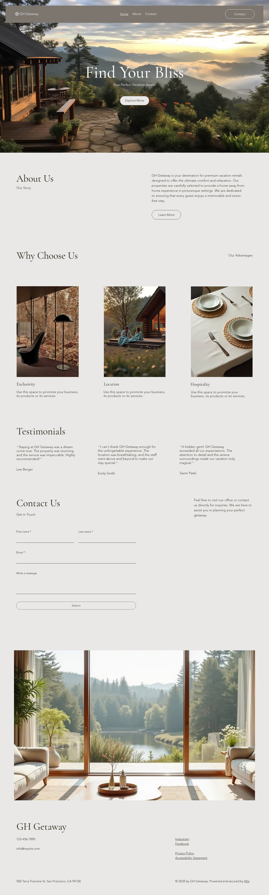

# Análisis de la referencia — Wix «WH Vacation Rent» (wh-1061)

> **Referencia**: [Wix · Compañía de Alquiler de Vacaciones (Cálido), plantilla wh-1061](https://es.wix.com/website-template/view/html/wh-1061)
> · **Demo renderizada medida**: `https://www.wix.com/demone2/wh-vacation-rent`
> · **Fecha de captura**: 2026-10-23 · **Método**: Chromium (Playwright) a 1440 px y 390 px; medición de
> `getBoundingClientRect`, `getComputedStyle` y muestreo de color sobre la captura.
> **Uso**: referencia interna de **distribución**. No se copian assets, textos ni código de la
> plantilla; las capturas se guardan en [`referencia/`](referencia) solo para trazabilidad.

---

## 1. Distribución medida (escritorio 1440 px)

La página mide **4.784 px** de alto y se compone de **ocho bloques**:

| # | Bloque | Alto | Composición |
|---|---|---|---|
| 1 | **Header** | 152 px | Transparente sobre el hero. Logo + icono a la izquierda, 3 enlaces (**Home · About · Contact**) centrados, CTA píldora outline a la derecha. |
| 2 | **Hero** | 816 px (≈82 vh) | Fotografía a sangre. H1 serif enorme centrado, subtítulo, un CTA píldora claro. Sin caja de reserva. |
| 3 | **About** | 438 px | Split asimétrico **5/7**: a la izquierda H2 serif + etiqueta pequeña («Our Story»); a la derecha párrafo y CTA outline. Sin imagen. |
| 4 | **Why Choose Us** | 934 px | H2 a la izquierda y etiqueta «Our Advantages» a la derecha. **3 columnas de imagen 4:5** con H3 y párrafo corto debajo. |
| 5 | **Testimonials** | 439 px | H2 a la izquierda. **3 columnas** de citas con autor. |
| 6 | **Contact Us** | 773 px | H2 + etiqueta; formulario de dos columnas con **inputs de filete inferior** (sin caja) y botón outline. |
| 7 | **Banda a sangre** | 952 px | Imagen full-width sin texto encima (pausa visual). |
| 8 | **Footer** | 432 px | Fondo greige. **Wordmark serif enorme** a la izquierda + teléfono/correo; 3 columnas de enlaces; fila inferior con dirección y copyright. |

### Ritmo y proporciones

- **Header ≈ 3 % del alto**, **hero ≈ 17 %**, y el resto se reparte en secciones de **438–952 px**.
- Márgenes laterales del contenido: **≈ 40–65 px**; el texto mide una línea corta (≈55–60 ch).
- Secciones separadas **solo por aire**; no hay tarjetas, bordes ni sombras. Los únicos filetes son
  los subrayados de los inputs y la línea del copyright.
- Repetición de **3 columnas** (ventajas y testimonios) como columna vertebral editorial.

### Móvil (390 px)

- El header se compacta: logo + **CTA píldora** + hamburguesa; sigue sobre el hero.
- Hero centrado, más corto; subtítulo y CTA apilados.
- Todas las secciones pasan a **una columna**; las imágenes 4:5 ocupan el ancho completo.
- Footer apilado con wordmark grande y enlaces en columna.
- No hay barra de acción fija ni CTA persistente: el usuario debe volver arriba para convertir.

---

## 2. Tipografía y color medidos

| Elemento | Valor medido |
|---|---|
| **H1** | **90 px**, `Cormorant Garamond` (peso 700), interlineado ≈0,98, centrado |
| **H2** | **52,9 px**, serif, alineado a la izquierda |
| **Cuerpo** | **18 px**, `Avenir` light (sin serif), interlineado ≈1,5 |
| **Navegación** | **16,9 px**, Avenir light |
| **Botones** | Píldora de **50 px** de alto, radio **112,5 px**, borde 1 px, **texto de 10 px** |
| **Fondo** | `#E9E8E7` (greige cálido) |
| **Texto** | `#362E22` (marrón oscuro) |
| **Texto de navegación** | `#FDFDFD` sobre la foto |
| **Acento de borde** | `#6A6348` |
| Tipografías equivalentes libres | **Cormorant Garamond** (ya libre) + **Manrope / Onest / Nunito Sans** en lugar de Avenir (propietaria) |

**Contraste calculado sobre los colores medidos**

| Par | Ratio | Lectura |
|---|---|---|
| Texto `#362E22` sobre fondo `#E9E8E7` | **10,93:1** | AAA ✅ |
| Etiqueta `#7C766F` sobre `#E9E8E7` (18 px) | **3,67:1** | ❌ no llega a AA para texto normal |
| Navegación `#FDFDFD` sobre la foto (media `#898E8A`) | **3,28:1** | ❌ no llega a AA para 16,9 px |
| Texto negro sobre botón `#E9E8E7` (10 px) | 17,16:1 | ✅ contraste, pero el **tamaño es insuficiente** |
| Píldora «Contact»: negro sobre `#7C766F` | 4,68:1 | ✅ justo, pero a 10 px |

> Conclusión: la referencia es **cromáticamente sólida** (fondo cálido + texto oscuro) y **falla en los
> detalles**: tamaños de texto de botón, etiquetas de bajo contraste y navegación sobre foto sin un
> velo garantizado. La propuesta conserva su atmósfera y corrige esas tres cosas.

---

## 3. Qué tomamos de la distribución

| Decisión | Se adopta | Por qué |
|---|---|---|
| **Cabecera de 3 zonas** | Logo izquierda · navegación centrada · acciones derecha | Da aire editorial y deja la marca como ancla visual |
| **Hero a sangre centrado** | Foto + velo + titular serif + subtítulo + CTAs | Es el registro «hotel boutique» que la marca necesita |
| **Relato asimétrico 5/7** | Título a la izquierda, texto a la derecha | Rompe la simetría de dashboard y da ritmo de revista |
| **3 tarjetas de imagen 4:5** | Sin tarjeta ni sombra; imagen + texto debajo | Fotografía protagonista; el precio se añade con jerarquía serif |
| **3 columnas de citas** | Citas + autor, sin cajas | Social proof discreta y creíble |
| **Banda inmersiva a sangre** | Imagen grande como pausa narrativa | Separa la compra de la experiencia |
| **Footer de wordmark grande** | Marca + contacto + 3 columnas de enlaces + fila legal | Cierre editorial y navegación completa |
| **Píldoras y filetes finos** | Botones pill y subrayados sutiles | Coherencia con el sistema de componentes existente |

## 4. Qué adaptamos al producto

| Referencia | Adaptación en Marina del Sol |
|---|---|
| 3 enlaces de navegación | La **IA real**: Inicio · Habitaciones · Catálogo · Subastas · El hotel ⌄ · Descubre ⌄ + Ayuda, wallet y CTA (los grupos desplegables ya existen con `
` nativo) |
| Sin conversión en el hero | **`BookingDock` flotante** con fechas, huéspedes y búsqueda; una sola acción primaria clara |
| Sin precios ni disponibilidad | Tarjetas con precio, estado (`Disponible`, `Suite`, `Reventa`, `Vendida`) y ventana de 90 días |
| Sin web3 visible | Trust strip: *Reserva directa · Sin comisiones · Pago verificado en cadena · Pase offline*; explicación honesta de estados |
| Sección «Why choose us» genérica | **Habitaciones** (3 tarjetas de imagen) + **ventajas numeradas** (reserva directa, noche en propiedad, pase digital) |
| Formulario de contacto en la home | **CTA final + tarjeta de contacto**; el formulario vive en `/contacto` (no se duplica) |
| Banda de imagen sin texto | **Banda de Experiencias** con copy y CTA sobre velo |
| Footer de plantilla | Footer real: 4 columnas, teléfono/correo, legal, idioma y redes |
| CTA píldora outline | Píldora clara para el hero (`shell` con tinta) y píldora azur para acciones funcionales |

## 5. Qué corregimos (deuda de accesibilidad de la referencia)

| Problema medido | Corrección en la propuesta |
|---|---|
| Botones con texto de **10 px** | CTA de **46 px** de alto y texto de **12 px** mínimo (píldoras) |
| Etiquetas `#7C766F` sobre greige (**3,67:1**) | Etiquetas con `ink-soft`/`coral-text` (≥4,5:1) y tamaño ≥12 px |
| Navegación blanca sobre foto (**3,28:1** de media) | **Velo al 70 %** + **scrim de cabecera** (compuesto ≥5,7:1 en las tres identidades) |
| Sin foco visible en los controles | **Doble anillo** de foco (token `azure` + halo porcelana) y navegación por teclado |
| Sin estado de error/carga/vacío visible | `SkeletonCard`, `EmptyState` y `DegradedState` con copy honesto |
| CTA solo al principio | **Barra de acción fija** en móvil y booking card pegajosa en ficha |
| Imágenes sin política de tamaño | `srcset/sizes`, formatos modernos, `fetchPriority` en el LCP |

## 6. Riesgos y límites

- **No se copian activos**: las fotografías de la demostración son de Wix; la propuesta usa las fotos
  reales del hotel en `docs/imagenes/`. La captura se conserva como referencia interna.
- **La plantilla es de otro negocio** (alquiler vacacional): no tiene catálogo, compra, reventa,
  check-in ni i18n. Su distribución se usa como **esqueleto**, no como flujo.
- **Avenir es propietaria**: se sustituye por las familias libres del proyecto (Manrope/Onest/Spectral,
  según la identidad) con cirílico.
- **La medición es del render público de Wix** en la fecha indicada; el editor puede variar. Las
  alturas citadas son las observadas, no un contrato.

## 7. Conclusión

La referencia aporta exactamente lo que la suite pública necesita recuperar: **aire, fotografía y
jerarquía editorial**. No aporta el motor de conversión ni la accesibilidad que el producto exige. La
propuesta «Marina Editorial» conserva el esqueleto (secciones, ritmo, proporciones y navegación) y le
injerta el sistema de reserva, los estados y la accesibilidad del proyecto.
