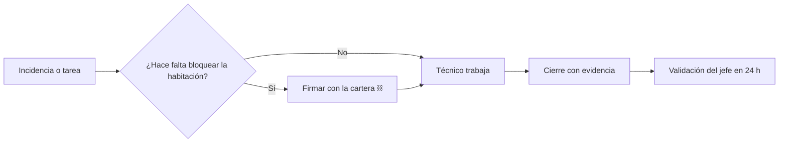

# Mantenimiento: guía del jefe y del técnico

> **Para quién es esta guía:** jefe de mantenimiento (usa el ordenador) y técnico de mantenimiento (usa el

terminal fijo del taller).

## Empezar en 5 minutos

1. **Jefe:** entra en el ordenador con tu usuario, contraseña y el código de 6 dígitos de tu aplicación de
   autenticación. Abre **Mantenimiento** en el menú.
2. **Jefe:** conecta tu cartera desde el bloque «Sesión» del menú lateral. La cartera solo se usa para
   **firmar** acciones críticas; tu contraseña y el código siguen siendo el acceso.
3. **Técnico:** en el terminal del taller, pulsa tu nombre, teclea tu PIN y elige una tarea de tu lista.
4. Haz tu trabajo y ciérralo con una nota y, si puedes, una foto.
5. El jefe revisa y valida el cierre en menos de 24 horas.

<!-- GENERAR_IMAGEN: suite-mantenimiento.svg -->

## 1. Ver el día

- **Tablero**: incidencias abiertas, preventivo vencido, habitaciones bloqueadas y áreas críticas.
- **Incidencias**: lista con prioridad y estado. Pulsa una para ver el historial y el detalle.
- **Preventivo**: tareas por fecha; las de áreas críticas (piscina, bomba, ascensor, generador) exigen
  firma.

## 2. Bloquear una habitación (acción con firma ⛓)

1. Abre la incidencia de la habitación averiada.
2. Pulsa **Bloquear para venta**.
3. Revisa la ventana que aparece: acción, habitación y motivo.
4. Confirma y firma en tu cartera.
5. La habitación deja de venderse hasta que se desbloquee.

> **Qué significa ⛓**: la acción queda registrada en la cadena con tu dirección y la hora. Solo quien
> tiene el rol puede firmarla; la web nunca firma por ti.

## 3. Cerrar una tarea

1. Escribe qué has hecho (y repuestos, si aplica).
2. Si la tarea es de un área crítica, firma el cierre.
3. Si no hay foto, la app te avisa (`evidence-missing`) pero te deja continuar.
4. El jefe verá el cierre como **pendiente de validación**.

## 4. Usar el terminal con PIN

- El PIN tiene 4–6 dígitos, no se repiten y caduca cada 90 días.
- Si fallas 5 veces, el terminal se bloquea 15 minutos; el jefe puede desbloquearte.
- El terminal **no funciona sin conexión**: si se cae la red, avisa y no deja escribir.
- Cierra sesión al terminar (se cierra sola a los 5 minutos de inactividad).

## 5. Si algo no funciona

| Síntoma | Qué hacer |
|---|---|
| «Requiere firma» y el botón no responde | Conecta la cartera y comprueba que estás en la red del hotel |
| «No autorizado» | Tu sesión caducó: vuelve a entrar con contraseña + código |
| El cierre se queda «pendiente de validación» | Es normal: el jefe tiene 24 h; si vence, escala al administrador |
| El terminal no me deja entrar | PIN caducado o bloqueado: pide al jefe que lo renueve o desbloquee |
