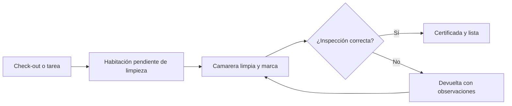

# Ama de llaves: guía de turnos, limpieza e inspecciones

> **Para quién es esta guía:** jefa de ama de llaves (ordenador) y camareras (terminal del office).

## Empezar en 5 minutos

1. **Jefa:** entra en el ordenador con tu usuario, contraseña y código de 6 dígitos. Abre **Ama de llaves**.
2. Crea el turno del día y asigna habitaciones a cada camarera.
3. **Camarera:** en el terminal del office, entra con tu PIN y verás solo tus habitaciones.
4. Marca cada habitación como limpia al terminar; si algo está roto, repórtalo.
5. La jefa inspecciona y certifica (o devuelve la limpieza).

<!-- GENERAR_IMAGEN: ama-de-llaves.svg -->

## 1. Turnos y asignaciones

- Un turno tiene fecha y etiqueta: **mañana**, **tarde** o **noche**.
- Cada habitación se asigna a una camarera; no se puede repetir la misma habitación en el mismo turno.
- El tablero muestra el estado de cada habitación (limpia, sucia, ocupada, pendiente, en inspección).

## 2. Para la camarera (terminal)

1. Entra con tu PIN y abre **Mis habitaciones**.
2. Elige una y marca el avance: **empezar** y **terminar**.
3. Registra el consumo de suministros si lo hubo.
4. Si ves una avería, usa **Reportar avería**; no necesitas cartera.
5. Al terminar, cierra sesión (o se cierra sola a los 5 minutos).

## 3. Para la jefa: inspeccionar

1. Abre **Inspecciones** y la habitación pendiente.
2. Elige el tipo: **check-out** o **servicio diario**.
3. Resultado: **aprobada** o **rechazada** con observaciones.
4. Si quieres, firma la certificación con tu cartera (es opcional).
5. Rechazar devuelve la limpieza a la camarera con tus notas.

## 4. Suministros

- Si un producto baja del umbral, aparece una **alerta**.
- La alerta se recuerda cada día hasta que repongas; al superar el umbral se cierra sola.
- La jefa puede cambiar el umbral de cada producto en administración.

## 5. Si algo no funciona

| Síntoma | Qué hacer |
|---|---|
| No veo mis habitaciones | Comprueba que estás en el turno correcto; pide a la jefa que revise la asignación |
| El PIN no funciona | Puede estar bloqueado o caducado: la jefa lo renueva desde Sistemas → Usuarios |
| «Sin conexión» en el terminal | El terminal necesita red; avisa a la jefa y usa el parte en papel |
| Una inspección rechazada no me llega | La habitación vuelve a tu lista con las observaciones |
