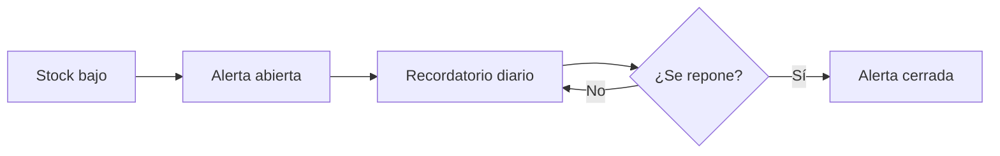

# Suministros y plazos de validación

> **Para quién es esta guía:** jefa de ama de llaves y administración.

## Empezar en 5 minutos

1. Entra en **Ama de llaves → Suministros**.
2. Revisa las alertas abiertas: son productos en o por debajo del umbral.
3. Repón el producto y vuelve a iniciar sesión; la alerta se cierra sola al superar el umbral.
4. Revisa la cola **Mantenimiento → Validaciones**: ahí esperan los cierres de tus técnicos.
5. Valida antes de 24 horas.

## 1. Cómo funcionan las alertas

- Cada producto tiene un **umbral** configurable.
- Cuando el stock queda **en o por debajo**, se abre una alerta.
- Mientras siga abierta, el sistema recuerda cada día al responsable.
- Al reponer por encima del umbral, la alerta se cierra automáticamente.

## 2. Plazo de validación de tareas (24 horas)

- Cuando un técnico cierra una tarea, queda **pendiente de validación** de su jefe.
- Si pasan **24 horas**, la tarea se marca como vencida y **escala al administrador**.
- Una tarea vencida **no bloquea la habitación**, pero **no cuenta como completada** hasta que se valide.
- En la cola verás el tiempo restante de cada tarea.

## 3. Si algo no funciona

| Síntoma | Qué hacer |
|---|---|
| No aparece una alerta aunque el stock es bajo | Comprueba el umbral del producto y que el worker esté activo |
| La alerta no se cierra al reponer | Verifica que el stock superó el umbral (no basta con igualarlo) |
| Una tarea venció y no la veo | Está en la vista del administrador; pídele que la reabra o valide |
