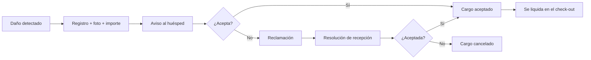

# Cargos por daños: registrar, reclamar y resolver

> **Para quién es esta guía:** recepción, ama de llaves (quien registra el daño) y huésped (quien recibe el

aviso).

## Empezar en 5 minutos

1. **Recepción/ama de llaves:** abre la estancia y pulsa **Registrar cargo por daños**.
2. Describe el daño, adjunta una foto e indica el importe.
3. El huésped recibe un aviso con el plazo para aceptar o reclamar.
4. Si acepta, el cargo se cobra en el check-out; si reclama, recepción resuelve.
5. La habitación queda libre de cargos pendientes al cerrar la estancia.

<!-- GENERAR_IMAGEN: doc-suite-danos-ciclo.svg -->

## 1. Registrar el cargo

- Describe el daño con claridad y adjunta una **foto** (solo JPG, máximo 2 MB).
- El importe **no puede superar 3 veces la tarifa de la noche**; por encima debe aprobarlo el administrador.
- El aviso al huésped se envía por su canal preferido con el plazo de reclamación.

## 2. Aviso y reclamación del huésped

- El huésped abre el enlace y ve la descripción, el importe y el plazo.
- Puede **aceptar** o **reclamar** con una nota.
- Si deja pasar el plazo, el cargo queda como vencido y no admite reclamación.
- No se muestran datos internos ni de otros huéspedes.

## 3. Resolver (recepción)

1. Abre **Recepción → Daños** y la reclamación.
2. Revisa la evidencia y las notas.
3. Resuelve: **aceptada** (se cobra) o **rechazada** (se cancela).
4. Al hacer el check-out, el sistema liquida los cargos aceptados.

## 4. Si algo no funciona

| Síntoma | Qué hacer |
|---|---|
| El huésped no recibió el aviso | Comprueba su canal preferido y reenvía el aviso |
| No puedo registrar el importe | Supera el tope de 3× la noche: pide aprobación al administrador |
| El cargo no aparece en el check-out | Revisa que esté aceptado y dentro del plazo |
| El enlace del aviso da error | Pide al huésped que entre en «Mis noches → Cargos» |
