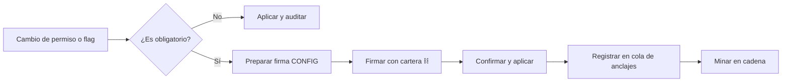

# Gobiernos de la plataforma: wallets, permisos y firmas

> **Para quién es esta guía:** propietario/administrador y soporte.

## Empezar en 5 minutos

1. Entra en **Sistemas** con tu cuenta de propietario.
2. Revisa **Usuarios** y **Wallets**: cada jefe debe tener su rol on-chain asignado.
3. Si cambias un permiso obligatorio, el sistema te pedirá firmar con la cartera.
4. Revisa la **cola de anclajes**: ahí ves las firmas pendientes de registrarse en la cadena.
5. Descarga el **expediente de auditoría** cuando lo necesites.

<!-- GENERAR_IMAGEN: gobernanza-firmas.svg -->

## 1. Wallets y roles de los jefes

- Cada jefe tiene una **dirección de wallet** y un rol: jefe de mantenimiento, jefa de ama de llaves o
  respaldo del propietario.
- El sistema **concede el rol en la cadena y comprueba que se aplicó** antes de guardarlo.
- Para dar de baja a alguien, primero se retira el rol en la cadena; si aún está activo, no deja.
- El respaldo del propietario sirve para firmar en una emergencia.

## 2. Permisos y flags

- Algunos permisos son **obligatorios** para operar con seguridad.
- Si intentas desactivar uno obligatorio, el sistema te pide **firmar** el cambio con la cartera.
- Todo cambio queda registrado con quién, cuándo y qué cambió.

## 3. Operarios del terminal

- Se dan de alta con un **PIN de un solo uso** que deben cambiar al entrar.
- Puedes rotar el PIN, darlos de baja y desbloquearlos si fallan 5 veces.
- Cada alta queda vinculada a la persona que la hizo.

## 4. Cola de anclajes, auditoría y copias

- **Cola de anclajes:** lista de firmas pendientes; si el servicio que las envía a la cadena se cae, la
  cola sigue visible y se reintenta.
- **Auditoría:** descarga un expediente firmado y verificable de las acciones.
- **Copias de seguridad:** el sistema tiene copia diaria y recuperación a un instante; el drill de
  restauración a una instancia aislada está documentado aparte.

## 5. Si algo no funciona

| Síntoma | Qué hacer |
|---|---|
| «Esta operación requiere firma» | Conecta la cartera del propietario y firma; sin firma no se aplica |
| No puedo dar de baja una wallet | El rol sigue activo en la cadena: retíralo primero |
| La cola de anclajes crece | Revisa el estado del worker; las firmas se reintentan solas |
| El expediente de auditoría no descarga | Comprueba tu sesión y vuelve a intentarlo; queda registrado el error |
