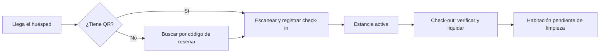

# Recepción vNext: el día en el mostrador

> **Para quién es esta guía:** recepcionista del hotel.

## Empezar en 5 minutos

1. Entra en el ordenador con tu usuario, contraseña y código de 6 dígitos.
2. Abre **Recepción**: verás las reservas del día y las 50 habitaciones.
3. Para un check-in, escanea el QR del huésped o busca la reserva por su código.
4. Para un check-out, verifica la habitación y confirma; los cargos aceptados se liquidan.
5. Si necesitas publicar o retirar una habitación de la venta, usa el botón de publicación.

## 1. El panel del día

- **Reservas:** llegadas, estancias activas y salidas.
- **Habitaciones:** estado de venta y estado operativo de cada una.
- **Incidencias:** puedes reportar una avería sin firma.
- **Daños:** consulta y resuelve reclamaciones de cargos.

## 2. Check-in

1. Escanea el QR con el lector o introduce el código del resguardo.
2. El sistema comprueba que es válido y que no se ha usado.
3. Si el QR falla, usa el **check-in de contingencia** (queda registrado y auditado).
4. La estancia pasa a activa y la habitación a ocupada.

## 3. Check-out

1. Abre la estancia y verifica la habitación.
2. Si hay daños, registra el cargo; si hay cargos pendientes, resuélvelos.
3. Confirma la salida: se liquidan los cargos aceptados.
4. La habitación pasa a **pendiente de limpieza** y aparece en la lista del ama de llaves.

## 4. Publicar o retirar la venta

- Puedes **pausar** o **volver a publicar** la venta de una habitación desde la ficha.
- La acción queda registrada y no exige cartera (es operación de recepción).
- Si el sistema de reservas externo (PMS) no responde, la operación manual sigue disponible y la web lo
  avisa.

## 5. Si algo no funciona

| Síntoma | Qué hacer |
|---|---|
| El QR no se lee | Introduce el código del resguardo o usa contingencia |
| «Este resguardo ya se usó» | No se puede repetir; revisa con el huésped y abre una incidencia |
| No veo una reserva | Búscala por código; si no aparece, comprueba la sincronización con el PMS |
| No puedo publicar la habitación | La ficha puede estar incompleta o bloqueada por mantenimiento |
