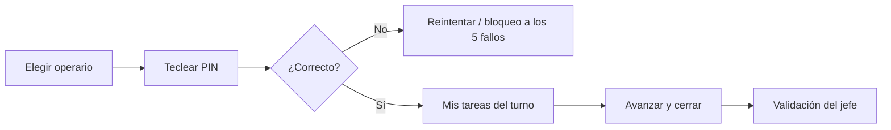

# El terminal con PIN: guía rápida

> **Para quién es esta guía:** técnicos de mantenimiento y camareras que trabajan con el terminal fijo.

## Empezar en 5 minutos

1. Enciende el terminal y pulsa tu nombre.
2. Teclea tu **PIN** (4–6 dígitos, sin repetir).
3. Verás **solo tus tareas y habitaciones** del turno.
4. Abre una tarea, trabaja y ciérrala con una nota (y foto si puedes).
5. Cierra sesión al terminar.

<!-- GENERAR_IMAGEN: doc-suite-terminal-pin.svg -->

## 1. Entrar y salir

- El PIN es personal; no lo compartas.
- Si fallas **5 veces**, el terminal se bloquea 15 minutos. Tu jefe puede desbloquearte.
- La sesión se cierra sola a los **5 minutos** sin actividad y, como máximo, a las 8 horas.
- El PIN caduca cada **90 días**; el sistema te pedirá cambiarlo.

## 2. Trabajar con tareas

1. Elige una tarea de tu lista (solo ves las asignadas a ti).
2. Pulsa **Empezar** cuando llegues.
3. Al terminar, escribe qué has hecho y adjunta evidencia si es posible.
4. Pulsa **Cerrar**: la tarea queda pendiente de validación de tu jefe.
5. Si ves una avería, usa **Reportar avería**.

## 3. Cosas importantes

- El terminal **necesita conexión**: si se cae la red, avisa y no intentes escribir.
- No puedes ver importes, huéspedes ni configuración: es intencionado.
- Si otra persona cambió la tarea mientras la tenías abierta, el sistema te avisa del conflicto.
- La camarera usa el mismo terminal para marcar la limpieza y el consumo de suministros.

## 4. Si algo no funciona

| Síntoma | Qué hacer |
|---|---|
| «PIN incorrecto» | Revisa mayúsculas/teclado; al quinto intento se bloquea |
| «PIN caducado» | Pide a tu jefe que lo renueve |
| No aparecen tareas | Puede que no tengas asignaciones en este turno; avisa a tu jefe |
| «Sin conexión» | Espera a que vuelva la red; el terminal no guarda cambios offline |
